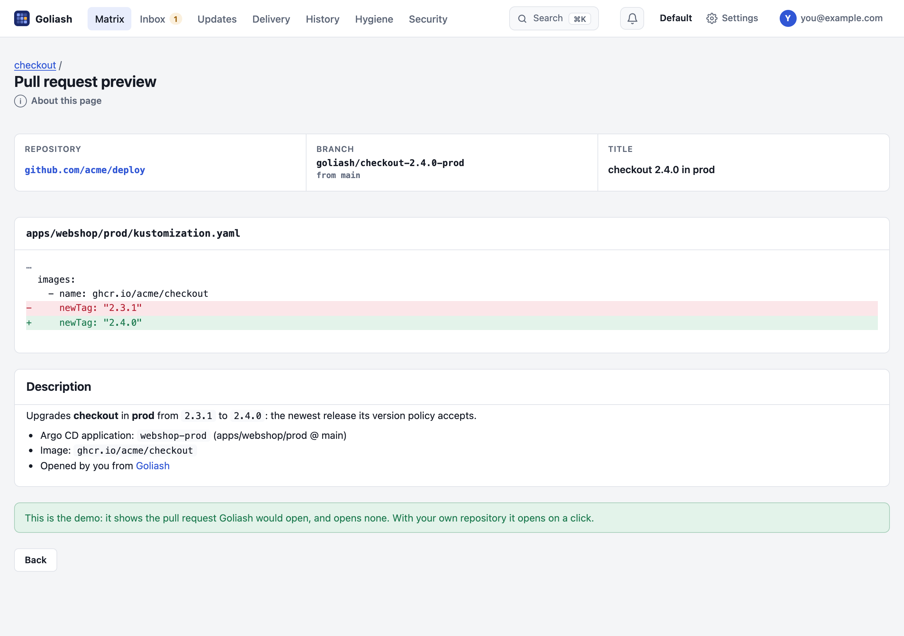
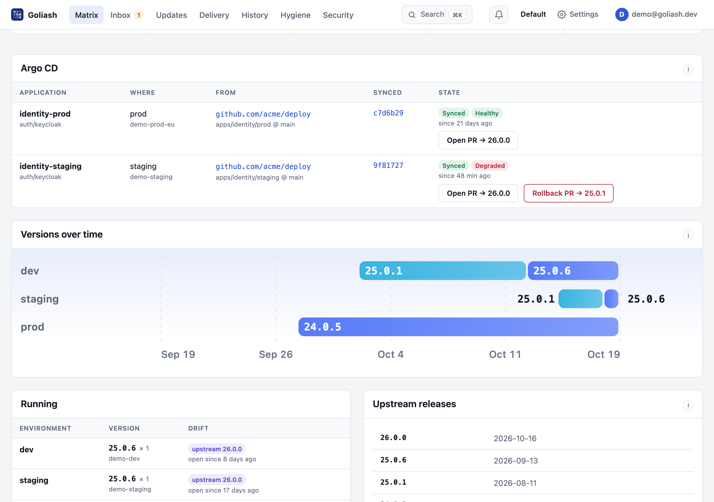

With Argo CD, Git says what should run and Argo CD makes it so. Goliash shows both sides on one page: what Git
declares for a service, which commit was last synced, whether Argo CD is in sync and healthy, and what actually runs,
on which version, against the newest release upstream.

## What you see

- **The service page** has an *Argo CD* panel: per environment and cluster, the application that deploys the
  service, its repository and path (or Helm chart) with the branch or tag it follows, the commit last synced (a link to
  the commit on GitHub, GitLab, Bitbucket or Gitea), and its sync and health status, with how long it has been so.
  Once the application syncs a new commit, **changes** links what changed in Git since the one before (a compare
  view on GitHub, GitLab or Gitea), and the alert for an application degraded or out of sync right after links the
  same, as *Git changes*.
  With a token for the repository (see [Set up](#set-up)), an application out of sync also says **which version Git
  pins** and which runs: *Git pins 1.7.0, runs 1.6.0*, the answer to "why did my change not go out?". It is read
  from the files under the application's path, at most every 10 minutes, never while you wait. The matrix cell's
  tooltip and the out-of-sync alert say the same.
- **The matrix and the tiles** mark a cell *Argo: out of sync*, *Argo: degraded* or *Argo: missing* when the
  application has been so for more than 10 minutes: Argo CD is out of sync for a moment on every change, and
  progressing while it rolls out, which is not news. On the tiles such a cell needs attention.

A notification rule with the `gitops` event (*Argo CD out of sync or degraded*) says so in Slack, Teams, e-mail or a
push, once per episode, with the commit last synced; Goli and AI assistants read the same through the `gitops` tool
and `GET /api/v1/gitops`, which for a degraded application also gives the version change in the day before it
(`after_change`). `GET /api/v1/pull-requests` and the `pull_requests` tool list the pull requests Goliash opened.

**GitOps applications** (`/gitops`, linked from the Delivery page and every GitOps panel) lists them all, on every
cluster, those degraded, missing or out of sync first, with what Git pins, the pull requests and the rollbacks on
offer; *Needs attention* leaves the rest out.

## Upgrade with a pull request

With `GOLIASH_GITOPS_TOKEN` set on the server, the panel offers **Open PR → 1.7.0** next to an application that runs
an older version than the newest release the service's [version policy](/guide/versions/#version-policy) accepts.
Goliash then, in the repository the application deploys from (GitHub, GitHub Enterprise or GitLab):

1. finds the YAML files under the application's path that pin the image at the running version: an image reference
   (`image: ghcr.io/acme/checkout:1.4.2`), Kustomize's `images` (`name` with `newTag`) or Helm values (`repository`
   with `tag`); other images, and the same tag of other images, stay as they are;
2. changes the tag on a new branch `goliash/<service>-<version>-<environment>`, from the branch the application
   follows;
3. opens a pull request (a merge request on GitLab, in one commit) saying what, where and why, with the release
   notes when known.

The **matrix** offers it too, in the cell (*PR → 1.7.0*, a link to the pull request once opened), to members.
The **Updates** page offers **Open PR** on the same lines, next to *Put off*, with a tick to open several at once
(**Open the ticked pull requests**, up to 20, each as its own pull request, or with *one per repository* as one
pull request per repository, branch and environment, a line per service), and the **Security** page next to
each service that runs behind a newer release, so the person who finds the exposure can propose the fix. The **Delivery** page does the same for
promotions: next to a version that runs in staging and waits for prod, **Open
PR → prod** pins that version in the repository of prod's application (one button per cluster when several run it),
saying since when it has run in staging. When several services of one application wait together, **Promote webshop-prod → prod** opens
one pull request that changes all their tags, in the files that pin them, with a line per service: the whole
application moves at once, as you would review it.



**Open PR** first shows a **preview**: the files that pin the image with the lines that change, the branch, the
title and the description, read from the repository and changing nothing; **Open the pull request** sends it. The
public demo shows the preview with made-up repositories and opens nothing.

With [Goli](/guide/goli/) on, the description also says **what changes**: Goli reads the release notes between the
two versions and lists, in a few lines, what breaks or needs a migration first, then the notable fixes, security
first. It is marked as Goli's, and asked once a day per upgrade.

Each pull request lists the known vulnerabilities the upgrade fixes (exploited in the wild first) and those it
brings, from the SBOMs of both images. It also says which packages the upgrade brings, or relicenses, under terms that need a look
before merging: network copyleft (AGPL, SSPL), source-available (BUSL, Elastic) or strong copyleft (GPL), with the
license they had before (operating system packages and permissive licenses left out; not legal advice). A version is proposed once: after that the page links the pull request, marked *merged* once it is. **Renovate, Dependabot
or a person** may have proposed it first: when an open pull request in the repository names the image and the version
in its title (*Update ghcr.io/acme/api Docker tag to v1.5.0*, *Bump api from 1.4.2 to 1.5.0*), the pages link that
one instead (hover: *Opened outside Goliash*), and neither a click nor a version policy opens a second. The **Delivery** page lists the pull
requests of the last 30 days, open, merged or closed, who opened them, and *running* once the version runs, with how long after opening it began to (*3h after
opening*) and the median over them all at the top: your time from proposal to production. asks the forge every 30 minutes, also what the checks (CI) say: *checks pass*, *checks running* or *checks fail*
next to the link, and once an alert (*Pull request failing*) when they fail; one closed without merging is offered again on the page (the version policy does not
open it again: closing it was a no).

### Roll back

When an application turns **Degraded** or **Missing** (for more than ten minutes) within a day of a service's
version replacing another on that cluster, the panel offers that service **Rollback PR → 1.6.2**: a pull request that pins the version
before again. Hover it to see why. The pull request says it rolls back, what went wrong and since when, and which
known vulnerabilities the older version brings back. As with every pull request, you review and merge it, and
GitOps deploys it.



The alert for a degraded or missing application says the same: *degraded on k8s-prod, an hour after 1.7.0
replaced 1.6.2*, the likeliest cause first. Its **Rollback PR → 1.6.2** button (Slack, Teams,
Discord, chat, e-mail) opens that pull request's preview in Goliash: from the alert to the fix in one click.

### Change freezes

During a [change freeze](/guide/change-freezes/) automatic pull requests wait, those opened by hand say they
were opened during one and their preview warns first; rollbacks are not held back.

### Reviewers and labels

A service's version policy can name who reviews its pull requests and how they are labelled: **Pull request
reviewers** `alice, @acme/payments` (people, and teams as `@org/team`) and **Pull request labels**
`dependencies, goliash` (`pr_reviewers` and `pr_labels` in the policy's JSON). GitHub and Gitea/Forgejo get both;
GitLab gets the labels and the people as reviewers. A name the forge does not know is skipped: the pull request
opens either way. A pull request for several services (a grouped upgrade, an application's promotion) asks
every service's reviewers and carries every service's labels.

### Automatic pull requests

A service's version policy can ask for them per environment: **Automatic pull requests** `dev=minor, staging=patch`
on its page (`"auto_pr": {"dev": "minor", "staging": "patch"}` in the policy) has Goliash open, every 30 minutes,
the pull request for dev when the newest acceptable release is at most a minor jump away, and for staging when it is
a patch. Production stays a decision, a click away. They are signed *auto-pr* in the pull request and the audit log;
one that cannot be opened (no file pins the tag) is tried again the next day.

Review and merge it as any change; Argo CD deploys it. Goliash never merges, never pushes to the branch an
application follows, and offers only the release the policy accepts. An image pinned by digest is left for you
(the new digest has to come with it).

The token is a [fine-grained GitHub token](https://github.com/settings/personal-access-tokens) limited to the deploy
repositories, with *Contents* and *Pull requests* read and write. For GitHub Enterprise set `GOLIASH_GITOPS_GITHUB_API`
to its API address (`https://github.example.com/api/v3`). For GitLab set `GOLIASH_GITOPS_GITLAB_TOKEN`: a project or
group access token with the `api` scope and the Developer role, on gitlab.com or the instance in `GOLIASH_GITLAB_URL`.
For **Gitea or Forgejo** (Codeberg too) set `GOLIASH_GITEA_URL` to the instance (`https://git.example.com`) and
`GOLIASH_GITOPS_GITEA_TOKEN` to an access token with `write:repository`; it needs Gitea 1.20 or Forgejo 1.20 or
newer. Several can be set at once: each repository goes to the forge of its host. Only members and admins see the button; each pull request is
in the audit log.

## Set up

Nothing to configure in Argo CD. The agent (or the server collecting its own cluster) reads Argo CD's
`Application` objects, read-only, and finds each workload among the resources an application lists. The Helm charts
grant `get` and `list` on `applications.argoproj.io`; with your own RBAC add:

```yaml
- apiGroups: ["argoproj.io"]
  resources: ["applications"]
  verbs: ["get", "list"]
```

Applications in any namespace are found (Argo CD's *apps in any namespace* included), and multi-source applications
show the source with a path or chart. Without Argo CD in the cluster, or without the permission, nothing changes.

To link application names to the Argo CD UI, set its address on the server:

```sh
GOLIASH_ARGOCD_URL=https://argocd.example.com
```

## Flux

With Flux the same panel, badges (*Flux: out of sync*, *Flux: degraded*), alerts and pull requests work from Flux's
own objects; nothing to configure in Flux either. Flux labels everything it applies with its Kustomization or
HelmRelease (`kustomize.toolkit.fluxcd.io/name`, `helm.toolkit.fluxcd.io/name`), and Goliash reads those with their
sources:

- a **Kustomization**: its GitRepository's URL and branch (or tag, semver), its path, and the commit last applied
  (`main@sha1:…`); *out of sync* when the GitRepository has a newer commit than the one applied, *degraded* when its
  `Ready` condition fails (reconciliation, health checks), *suspended* when suspended;
- a **HelmRelease**: its chart, the version it follows and the one applied, and its HelmRepository; a HelmRelease
  wins over the Kustomization that applied it.

`ssh://git@github.com/acme/deploy` and `git@…` addresses link to the repository's web page, and pull requests work
for them as for Argo CD. The Helm charts grant `get` and `list` on Flux's `kustomizations`, `helmreleases`,
`gitrepositories` and `helmrepositories`.

## Without Argo CD or Flux

Nomad jobs, Compose files and ECS task definitions live in Git too. Name the place in the workload's labels and the
same pull requests work, without a GitOps tool:

| Label | |
| --- | --- |
| `goliash.git.repo` | The repository: `https://github.com/acme/infra` (GitHub, GitLab, Gitea or Forgejo, with the token above) |
| `goliash.git.path` | The file, or a directory of files, that pins the image: `nomad/vault.nomad.hcl` |
| `goliash.git.branch` | The branch, when not the repository's default |

On Nomad they go in the job's `meta` (job, group or task); on Docker, Compose and Swarm in `labels`; on ECS as tags.

```hcl
job "vault" {
  meta {
    "goliash.git.repo" = "https://github.com/acme/infra"
    "goliash.git.path" = "nomad/vault.nomad.hcl"
  }
  # …
}
```

The service page then shows a **Git** panel with **Open PR**, and the Updates, Security and Delivery pages, the
`auto_pr` version policy, the preview and the reminders work as for Argo CD. Goliash changes the tag where the file
pins it, in HCL (`image = "hashicorp/vault:1.17.2"`), YAML, JSON task definitions or Terraform. A service without
the labels shows its members the lines to add, for the platforms it runs on. With no sync state to read, there is no *out of
sync*, *Git pins* or rollback offer: those need Argo CD or Flux.

## Why it helps

- **Drift with a cause.** A service behind upstream or behind the previous environment, and the commit and path that
  pin it: one click to the line to change.
- **Out of sync for an hour** is a deploy that did not happen: a sync window, a failing hook, auto-sync off. Goliash
  shows it next to the version that still runs.
- **Hand changes** stand out: *OutOfSync* while the running version differs from what Git declares.
