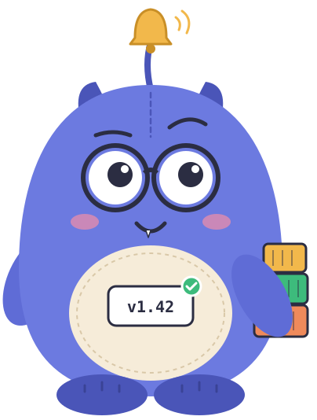
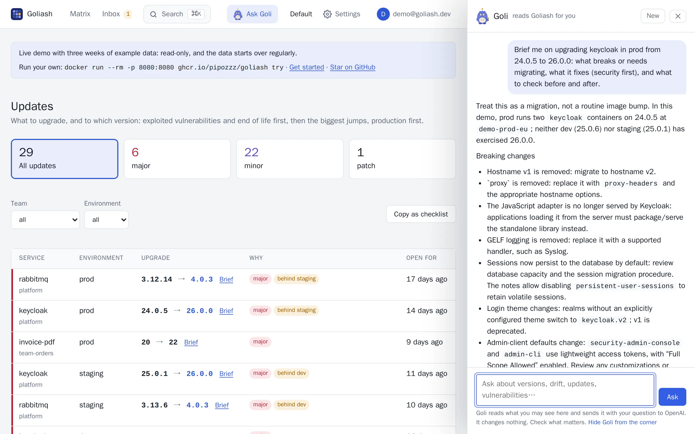

**Goli** is the assistant inside Goliash, the gentle giant with the release bell. Ask it in plain words, in any
language, and it looks things up for you in Goliash's live data, **as you**: it sees exactly what you may see in the
current workspace, it only reads, and every answer links to the pages that show the details.

Goli is off until you give the server a model: Claude (the default), OpenAI, or any OpenAI-compatible server, a
local one included. See [Turn it on](#turn-it-on). Try it on the [live demo](https://demo.goliash.dev), where it
answers over the example data.

## Brief me on this upgrade

The question Goli answers best is the one every upgrade raises: *what will this break?* Every upgrade on the
[Updates](/guide/versions/#updates) page, and a service's latest version on its page, has a **Brief** button. Goli
reads the release notes of **every release between what runs and the target**, from the project's GitHub or GitLab
releases, and tells you:

1. what breaks or needs migrating, first;
2. what it fixes, security first;
3. what to check before and after.



Asked to brief rabbitmq 3.12.14 → 4.0.3, Goli reads four releases of notes and starts with *do not upgrade prod in
place: 4.0 requires going through 3.13.x with all stable feature flags enabled*, then lists classic queue mirroring
removed, CQv1 storage removed, quorum queues defaulting to 20 redeliveries and the smaller maximum message size. Ten
pages of release notes become a checklist in half a minute.

Goli says so when the notes are silent about something, and it never calls an upgrade safe: the decision stays
yours.

## What to ask

**SREs and platform teams**

- "What changed in prod in the last two hours?"
- "Which version of payments ran in prod last Friday at 18:00?"
- "What drifted between staging and production this week, and since when?"
- "Is any of the data stale right now? Which agents are silent?"
- "What waits in staging to be promoted?"

**Developers and service owners**

- "Brief me on upgrading rabbitmq from 3.12.14 to 4.0.3."
- "Where does checkout run, and is anything behind upstream?"
- "Which of our team's services are on a release that reaches end of life this year?"

**Security officers and auditors**

- "Is Log4Shell (CVE-2021-44228) running anywhere? Since when, and what fixes it?"
- "Which vulnerabilities exploited in the wild run in production?"
- "How long has production run behind an available fix?"
- "Which images have no SBOM, so we cannot see inside them?"

Goli answers short and concrete, leads with the answer, and says so when the data does not cover something or may be
stale. It never invents versions, services or CVEs, but it is a language model: follow its links before you act.

## Where to find it

- **Ask Goli** in the header, or **Goli in the corner** of every page: the plushie opens the panel. It never pops up
  by itself; *Hide Goli from the corner* in the panel sends it away for your browser (the header button stays).
  Goli dresses for the season: a carved pumpkin around Halloween, a Santa hat in December, a scarf in January and
  February, sunglasses in summer (`GOLIASH_GOLI_SEASON=off` keeps it plain). With ten unread notifications or more
  it is swamped instead: tired eyes, the fourth coffee, its stack of containers turned into toppling alerts, the
  bell ringing, and a sigh: *Always something!* It follows the bell's count as it changes
  (`GOLIASH_GOLI_SEASON=swamped` shows it any time).
- **Ctrl+K** (⌘K): type a question and pick *Ask Goli*.
- **Brief** on every upgrade and next to a service's latest version (see above).
- **Explain** on every [vulnerability](/guide/security/): what it is in plain words, where it runs, whether it is
  exploited in the wild, what fixes it and how urgent it is here.
- **Suggestions** in the empty panel fit the page: questions about the service you are looking at, about
  vulnerabilities on the security pages, about a moment in time when you travel back.
- **Copy** on an answer puts it on the clipboard as Markdown, with links back to Goliash, for a ticket or a chat.

The panel stays open while you move between pages, and Goli is told which page you are on, so "why is this red?"
works. The conversation lives in your browser tab until you start a new one; Goliash keeps no copy.

While Goli works its eyebrow goes up and its bell rings; it dings once when the answer is there.

## What Goli can see and do

Goli uses the same read-only tools as the [MCP server](/reference/mcp/), through the REST API, with your session:

| Tool | What Goli reads |
| --- | --- |
| `matrix` | What runs where, now or at a past time |
| `service` | One service: versions per environment, newest upstream release, open drift |
| `drifts` | Open drift of every kind |
| `updates` | What to upgrade, most urgent first, and why |
| `release_notes` | The release notes between two versions, from GitHub or GitLab |
| `changes` | What changed recently: deploys, new releases, drift |
| `licenses` | Licenses of packages in running images, copyleft and unknown ones first |
| `rollouts` | Rollouts that do not finish: services down, stuck with two versions, short of replicas |
| `gitops` | Argo CD and Flux applications: repository, path, commit last synced, out of sync or degraded and since when, and the version change just before a degraded one |
| `pull_requests` | Pull requests Goliash opened: open, merged or closed, and whether their version runs |
| `vulnerabilities` | Known vulnerabilities in running images, exploited ones first |
| `posture` | The security posture: how long production runs behind fixes, end of life, accepted risk, blind spots |
| `notifications` | What Goliash sent you: alerts, digests and upgrade plans, as under the bell |
| `images` | One service's images: size against its budget, base, signature/SBOM/provenance, 90 days of sizes and what the last deploy changed in the layers |
| `inventory`, `hygiene` | Every running image with its size and whether its base is current; image hygiene, outdated bases included |
| `delivery`, `promotions` | Deploys over time; what waits to be promoted |
| `status` | Whether the data is fresh |

It **cannot change anything**: acknowledging drift is left out, and the connection it uses refuses anything but
reading. Ask it to change something and it tells you where in Goliash to do it. Text inside your data (release notes,
labels, image names) is given to Goli as data, never as instructions, and since Goli can only read, a crafted release
note cannot make it do anything.

## Turn it on

Goli needs a model. Set the variables on the server and restart it; the Status page then says
**Goli, the assistant: On, answering with …**.

### Claude (default)

```sh
GOLIASH_AI_API_KEY=sk-ant-… goliash serve
```

Goli uses `claude-opus-5-5` unless `GOLIASH_AI_MODEL` names another, e.g. `claude-sonnet-5-5` for lower cost.

### OpenAI

```sh
GOLIASH_AI_PROVIDER=openai GOLIASH_AI_API_KEY=sk-… GOLIASH_AI_MODEL=gpt-6.1-sol goliash serve
```

Name the model: pick one that handles tool calls well (OpenAI's model list shows which). Goli talks to OpenAI through
the Responses API, which its newer models need for tool calls, and asks OpenAI to keep nothing (`store: false`).

### Any OpenAI-compatible server, a local one included

Azure OpenAI or Bedrock through a gateway such as LiteLLM, OpenRouter, Groq, or a model on your own hardware with
Ollama or vLLM. With a local model nothing leaves your network, and no key is needed:

```sh
GOLIASH_AI_PROVIDER=openai GOLIASH_AI_BASE_URL=http://ollama:11434/v1 GOLIASH_AI_MODEL=<model> goliash serve
```

With a base URL Goli speaks Chat Completions; set `GOLIASH_AI_API=responses` for a gateway that passes the Responses
API through. Goli is only as good as the model behind it: small local models often handle tools poorly.

### Docker Compose

```yaml
services:
  goliash:
    image: ghcr.io/pipozzz/goliash:latest
    environment:
      GOLIASH_AI_PROVIDER: ${GOLIASH_AI_PROVIDER:-anthropic}
      GOLIASH_AI_MODEL: ${GOLIASH_AI_MODEL:-}
      GOLIASH_AI_API_KEY: ${GOLIASH_AI_API_KEY}   # from .env or your platform's secrets
      GOLIASH_AI_PER_HOUR: "30"
      GOLIASH_AI_PER_DAY: "300"
```

### Kubernetes (Helm)

Keep the key in a Secret and point the chart at it:

```sh
kubectl create secret generic goliash-ai -n goliash --from-literal=api-key=sk-…
helm upgrade goliash oci://ghcr.io/pipozzz/charts/goliash -n goliash --reuse-values \
  --set goli.existingSecret=goliash-ai --set goli.existingSecretKey=api-key \
  --set goli.provider=openai --set goli.model=gpt-6.1-sol --set goli.perDay=300
```

The chart also takes `goli.effort`, `goli.baseURL`, `goli.api`, `goli.perHour` and `goli.planSummary`. The pods need
egress to the provider's API.

### All settings

| Variable | Default | Meaning |
| --- | --- | --- |
| `GOLIASH_AI_PROVIDER` | `anthropic` | `anthropic`, or `openai` for OpenAI and any OpenAI-compatible server |
| `GOLIASH_AI_API_KEY` | | The provider's API key; Goli is off without it (except a compatible server with a base URL). `GOLIASH_AI_API_KEY_FILE` reads it from a file |
| `GOLIASH_AI_MODEL` | `claude-opus-5-5` | The model; required with `openai` |
| `GOLIASH_AI_BASE_URL` | the provider's API | A gateway or proxy, or the OpenAI-compatible server |
| `GOLIASH_AI_API` | `responses` for OpenAI, `chat` with a base URL | With `openai`: the Responses API or Chat Completions |
| `GOLIASH_AI_EFFORT` | `medium` | How hard the model thinks: `low`, `medium` or `high` (sent to OpenAI only when set, for models that take it) |
| `GOLIASH_AI_PER_HOUR` | `60` | Questions one person may ask per hour |
| `GOLIASH_AI_PER_DAY` | `0` (none) | Questions everyone together may ask per day on one server: a ceiling on the cost |
| `GOLIASH_AI_PLAN_SUMMARY` | off | `true` opens each [upgrade plan](/guide/notifications/#upgrade-plan) with Goli's take |
| `GOLIASH_DEMO_GOLI` | off | `true` offers Goli on a public demo; see [On a public demo](#on-a-public-demo) |

An `ANTHROPIC_API_KEY` or `OPENAI_API_KEY` that happens to be in the server's environment does not turn Goli on: it
is a choice to make on purpose.

## Goli in Slack

A Slack app's `/goli` command asks Goli from any channel:

```text
/goli what changed in prod in the last two hours?
```

Slack shows *Goli is looking* at once, and the answer follows in Slack's formatting, with links back to Goliash. Only
the asker sees it, unless `GOLIASH_SLACK_IN_CHANNEL=true`.

1. Create a Goliash API token for Goli in Slack; viewer is enough, and Goli sees what the token may see:
   `goliash token create -name slack-goli`.
2. Create the Slack app at [api.slack.com/apps](https://api.slack.com/apps) → *From a manifest*:

   ```yaml
   display_information:
     name: Goli
     description: Asks Goliash what runs where
   features:
     bot_user: { display_name: Goli }
     slash_commands:
       - command: /goli
         url: https://goliash.example.com/integrations/slack/goli
         description: Ask Goli about what runs where
         usage_hint: what changed in prod in the last two hours?
   oauth_config:
     scopes:
       bot: [commands]
   ```

3. Install it to the workspace and set on the server:

| Variable | Meaning |
| --- | --- |
| `GOLIASH_SLACK_SIGNING_SECRET` | The app's *Signing Secret* (Basic Information): every request is checked against it, and requests older than five minutes are refused |
| `GOLIASH_SLACK_GOLI_TOKEN` | The API token from step 1 |
| `GOLIASH_SLACK_IN_CHANNEL` | `true` posts answers to the channel; otherwise only the asker sees them |

The hourly limit counts per Slack user, the daily ceiling with everyone else's questions. Answers go only to Slack's
own response URL (`hooks.slack.com`), and the log names the workspace and the tools Goli used, never the question.

## Costs and limits

Goli costs what the provider charges for its tokens, on your account. A question usually takes two to four model
calls: Goli looks something up, reads it, and answers. The instructions and tool descriptions are the same for every
question and are cached by the provider, which makes them cheap after the first; a brief that reads long release
notes costs more than "is anything stale?".

Keep it in check with:

- **`GOLIASH_AI_PER_HOUR`**, per person (per visitor address on a demo);
- **`GOLIASH_AI_PER_DAY`**, a ceiling for everyone together on one server, counted from midnight UTC; each server
  of a cluster counts its own;
- **the model and effort**: a smaller model or `GOLIASH_AI_EFFORT=low` costs less per question;
- **a budget at the provider**, the only hard limit: give Goliash its own key in a separate Anthropic workspace with
  a monthly spend limit, or an OpenAI project with a budget. When it runs out, Goli says the limit is reached.

The **Status** page shows what Goli used today: questions against the daily ceiling, input tokens (and how many came
from the cache) and output tokens, for Goli and for Goli on your website.

## Goli's take on the upgrade plan

With `GOLIASH_AI_PLAN_SUMMARY=true`, every [upgrade plan](/guide/notifications/#upgrade-plan) your notification rules
send opens with a few sentences from Goli: what to upgrade first and why, and what can wait. Only the plan's own
lines go to the model, in one call per plan and channel; if it cannot be reached, the plan goes without.

## What leaves your server

Your question, the last turns of the conversation, the workspace's name, your role, the page you are on and **what
Goli looks up** (service names, versions, environments, images, vulnerabilities, release notes) go to the model's
API over TLS. Nothing else does: no credentials, tokens, registry secrets or data of other workspaces. With a local
model, nothing leaves your network.

Anthropic and OpenAI do not train on API traffic by default; see
[Anthropic's commercial terms](https://www.anthropic.com/legal/commercial-terms) and
[OpenAI's business terms](https://openai.com/policies/business-terms/). For zero data retention or a regional
deployment, talk to the provider or put your own gateway in `GOLIASH_AI_BASE_URL`. The panel tells everyone which
provider answers.

The server log records who asked, in which workspace, which tools Goli used and how long it took, never the
question.

## On a public demo

A public demo (`goliash try -public`) offers Goli only with `GOLIASH_DEMO_GOLI=true`, because there anyone on the
internet asks with your money. Then:

- everyone is the same viewer, so the hourly limit counts per visitor address (set `GOLIASH_TRUST_PROXY=true`
  behind a proxy);
- Goli reads a third as much of each tool result;
- it is told it is a demo with generated data, and to stay on Goliash and that data.
- a first question answered in the last six hours (the Brief and Explain buttons ask the same ones over and over) gets
  that answer replayed at once, with no model call and no limit spent.

Give it a low `GOLIASH_AI_PER_DAY` and a key with its own budget.
[deploy/demo](https://github.com/pipozzz/goliash/tree/main/deploy/demo) has a Compose file with every setting.

## Goli on your website

Goli can also answer questions about a product from its documentation, as it does in the corner of goliash.dev: no
access to any data, only the text you give it. Point a server that has a model at the documentation as one plain
text (an [llms-full.txt](https://llmstxt.org); goliash.dev publishes [its own](https://goliash.dev/llms-full.txt)) and
name the sites that may ask:

| Variable | Default | Meaning |
| --- | --- | --- |
| `GOLIASH_DOCS_ASSISTANT` | | URL of the documentation text; read again every hour. Turns on `POST /goli/docs` |
| `GOLIASH_DOCS_ASSISTANT_ORIGINS` | `https://goliash.dev` | Comma-separated sites whose pages may ask (CORS) |
| `GOLIASH_DOCS_ASSISTANT_MODEL` | Goli's model | A model of its own for the documentation, often a cheaper one |
| `GOLIASH_DOCS_ASSISTANT_PER_HOUR` | `20` | Questions one visitor may ask per hour |
| `GOLIASH_DOCS_ASSISTANT_PER_DAY` | `500` | Questions everyone together may ask per day |

The endpoint reads no cookies and changes nothing; questions are not stored or logged. It streams server-sent events
like the panel does (`text`, `done`, `error`) and names its provider in the `X-Goli-Via` header. The documentation is
cached by the provider between questions, so each one costs little more than its answer.

## Troubleshooting

**No Goli in the header.** The server has no model: the Status page says *Off* and how to turn it on. On a public
demo, also set `GOLIASH_DEMO_GOLI=true`.

**"Goli cannot reach its model: the server's GOLIASH_AI_API_KEY was refused."** The key is wrong, revoked, or meant
for another provider: an OpenAI key needs `GOLIASH_AI_PROVIDER=openai`.

**"Goli's model was not found."** Check `GOLIASH_AI_MODEL` (the exact model ID) and `GOLIASH_AI_BASE_URL`
(OpenAI-compatible servers usually end in `/v1`).

**"The model is busy or the organization's limit is reached."** The provider's rate limit or budget; try later or
raise it there.

**"You asked Goli a lot this hour" / "as many questions today as this server allows".** `GOLIASH_AI_PER_HOUR` or
`GOLIASH_AI_PER_DAY`.

**Answers are vague or Goli never looks anything up.** The model handles tools poorly; pick a stronger one. With
OpenAI's newer models, make sure Goli uses the Responses API (the default without a base URL).

**Goli does not show up on the website.** The widget appears only when `OPTIONS` on the endpoint answers `204`:

```sh
curl -i -X OPTIONS https://demo.goliash.dev/goli/docs
```

It remembers the answer for the browser tab, so open a new one after fixing the server.
