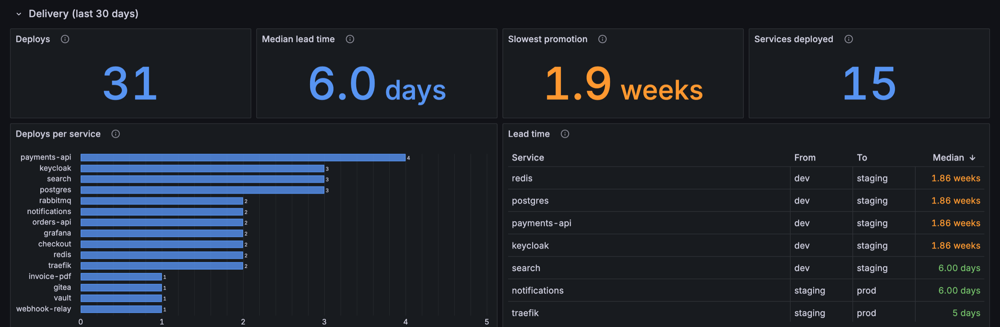

Goliash serves what runs where, drift, delivery speed, security posture and its own health at `/metrics`. Scrape
it with Prometheus, import the ready-made dashboard, and Grafana shows it next to the rest of your graphs, with a
marker for every deploy.


The quickest way is **Settings → Integrations** in Goliash: it creates a viewer token with one click and shows the
scrape settings filled in for your server, next to a download link for the dashboard. The steps below do the same by
hand. On Kubernetes, the [Helm chart](#kubernetes) sets up all of it.

## 1. A token for Prometheus

`/metrics` needs an API token with the viewer role. Create one under **Users → API tokens**, or:

```sh
goliash token create -name metrics -role viewer
```

Save the `glsh_api_…` value in a file Prometheus can read, e.g. `/etc/prometheus/goliash-token`.

## 2. Scrape Goliash

```yaml
scrape_configs:
  - job_name: goliash
    scrape_interval: 60s
    scheme: https
    authorization:
      credentials_file: /etc/prometheus/goliash-token
    static_configs:
      - targets: [goliash.example.com]
```

Grafana Alloy and Grafana Cloud take the same settings in a `prometheus.scrape` block; VictoriaMetrics reads the same
`scrape_configs`.

## 3. Import the dashboard

Download [`deploy/grafana/goliash-dashboard.json`](https://github.com/pipozzz/goliash/blob/main/deploy/grafana/goliash-dashboard.json),
then in Grafana open **Dashboards → New → Import**, upload the file and pick the Prometheus data source. The
*Environment* and *Service* filters at the top apply to every panel.

- **Versions and drift:** services behind upstream, open drifts and the oldest, what runs where, services running
  more than one version.
- **Delivery (last 30 days):** rollouts stuck or down (and a table of them), deploys, rollbacks and the change failure rate, the median and slowest lead time from one environment to the next, deploys
  per service and the lead time table. Lead time needs at least two environments; with only one, its panels stay
  empty.
- **Security posture:** how long production has run behind available releases (median and 90th percentile, and
  over time: is patching getting faster?), services behind for 30 and 90 days, past end of life, accepted risk, and
  the longest exposed services, and packages by license class (copyleft, source-available and unknown ones that
  need a look).
- **Vulnerabilities:** exploited ones (CISA KEV), those past CISA's due date, how long the oldest exploited one has
  run, critical ones, and vulnerabilities by severity over time.
- **Image hygiene:** moving tags, tags pushed again, untrusted registries, outdated bases, sizes over budget and
  images without a digest.
- **Images:** what pulling each service's image downloads over time and against its size budget, bases with a newer
  build than the image is built on, images missing a signature, SBOM or provenance, and layer counts.
- **Goliash itself:** agents online and stale, snapshots waiting, failing notifications, the server running the
  background work and the running version.



## 4. Deploys on your graphs

**From the metrics.** The Goliash dashboard has a *Deploys* annotation that marks every new version, read from
`goliash_deployed_version_info`. To get the same markers on any other dashboard, add an annotation query on the same
Prometheus data source:

```promql
count by (service, environment, version) (
  goliash_deployed_version_info{environment="prod"} unless goliash_deployed_version_info offset 10m
)
```

with *Title* `{{service}} {{version}}` and *Tags* `environment,service`. A latency spike right after a marker says
which deploy to look at first.

**From Goliash events.** A [Grafana channel](../notifications/#deploys-on-your-dashboards) writes every event as an
annotation tagged `goliash`, the event type, the service and the environment, at the moment Goliash saw it. The
Goliash dashboard has a *Goliash events* annotation for them, off by default.

## 5. Alerts

Ready-made Prometheus rules are in
[`deploy/prometheus/goliash-alerts.yaml`](https://github.com/pipozzz/goliash/blob/main/deploy/prometheus/goliash-alerts.yaml)
(also a download on the Integrations page): add the file to `rule_files` in `prometheus.yml`, or paste the queries
into Grafana alerting. The full list is in [Metrics and alerts](../observability/#alerts).

## Kubernetes

With the Prometheus Operator (kube-prometheus-stack) and Grafana's dashboard sidecar, the Helm chart sets up all of the
above. Create the token secret first, then turn the parts on:

```sh
kubectl create secret generic goliash-metrics --from-literal=token=glsh_api_…
helm upgrade --install goliash oci://ghcr.io/pipozzz/charts/goliash \
  --set metrics.serviceMonitor.enabled=true \
  --set metrics.serviceMonitor.labels.release=kube-prometheus-stack \
  --set metrics.prometheusRule.enabled=true \
  --set metrics.prometheusRule.labels.release=kube-prometheus-stack \
  --set metrics.grafanaDashboard.enabled=true
```

The `release` label must match your Prometheus' `serviceMonitorSelector` and `ruleSelector`; the dashboard ConfigMap
carries `grafana_dashboard: "1"`, which the sidecar of kube-prometheus-stack looks for.

Using SigNoz instead? See [SigNoz dashboard](../signoz/).
