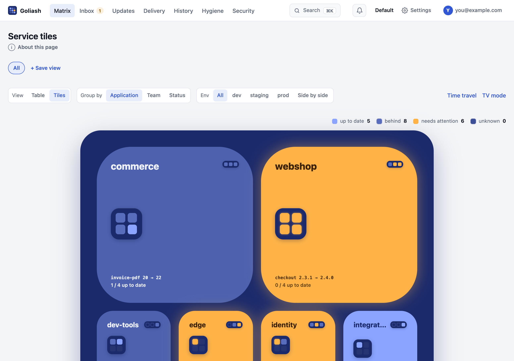
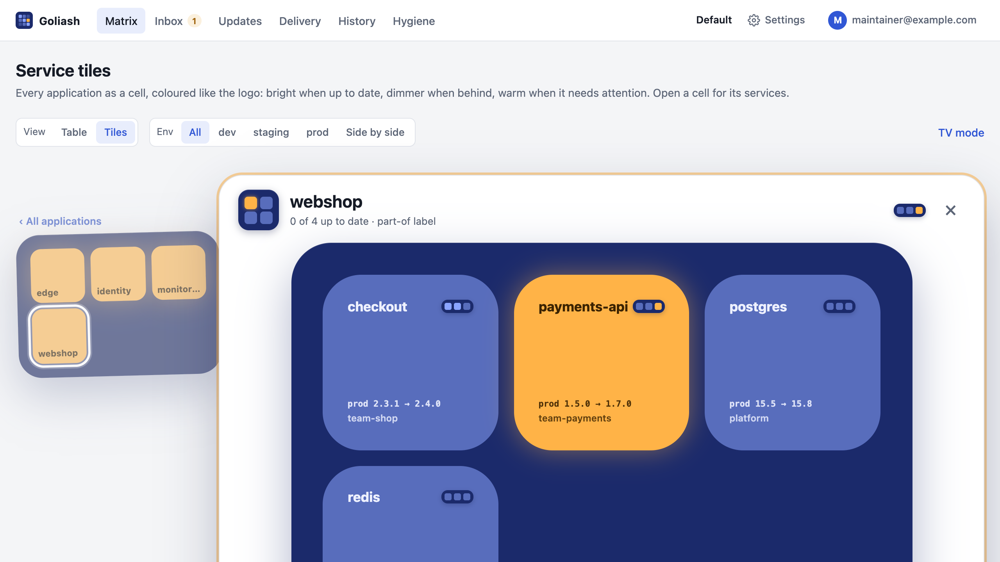
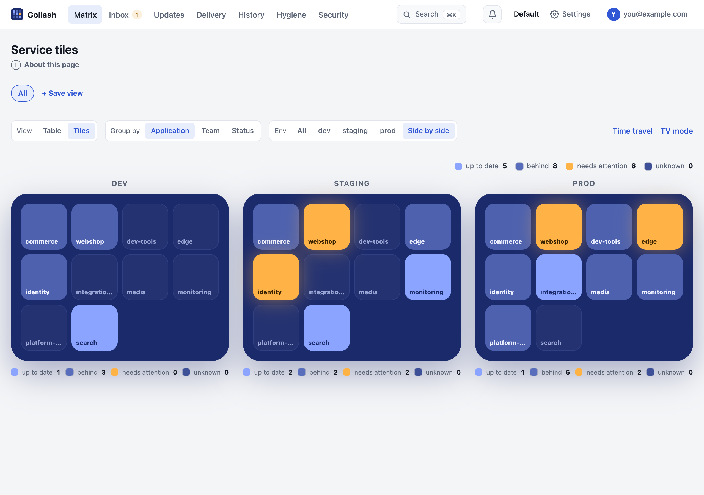
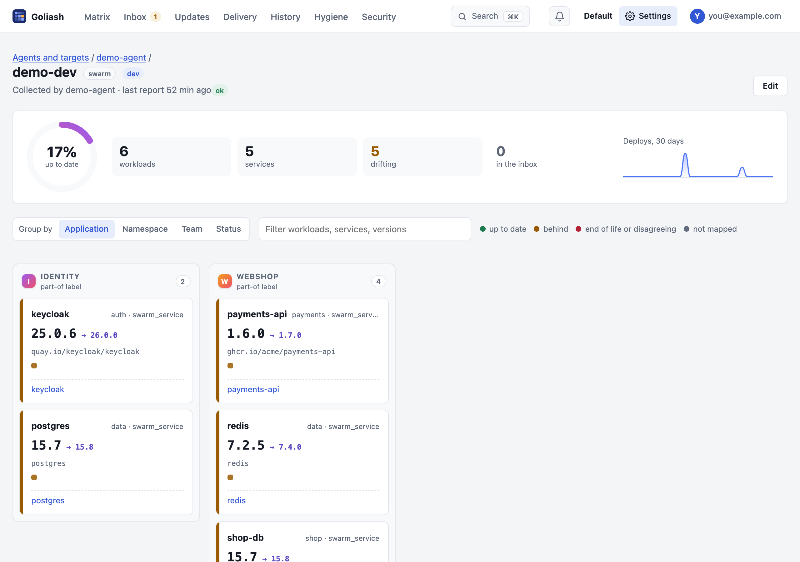
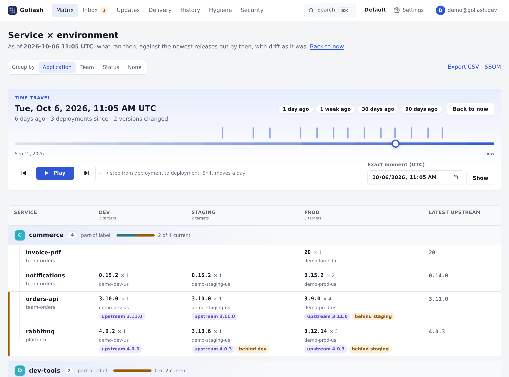

## The matrix

The matrix has one row per **service** and one column per **environment**, in promotion order (dev, staging,
prod). Each cell shows the versions running there, with replicas and the targets they run on. The last column shows
the newest upstream version the service's policy accepts.

**Filter** the matrix by typing above it (press <kbd>/</kbd> to jump there): every word must appear in the service,
its owner, a version, a target or a badge, so `team-payments end` finds that team's services on an end-of-life
release. **Only with drift** hides the rest. The filter is part of the address, so a filtered matrix can be
bookmarked or shared. **Time travel** shows the matrix as of a past moment; **Export CSV** downloads the inventory.


On a phone the matrix turns into one card per service, with each environment as a row inside it, so nothing scrolls
sideways. The same filter and drift switch work there.

Badges in a cell:

| Badge | Meaning |
| --- | --- |
| behind *env* | This environment runs an older version than the one before it. |
| upstream *x.y.z* | A newer release exists, at least as large a jump as the policy tracks. |
| targets disagree | Targets of this environment run different versions. |
| stale data | The agent stopped sending heartbeats, or there has been no snapshot for three poll intervals (at least 15 minutes). |

During a rollout, both versions show with their replica counts. The matrix updates live as snapshots arrive.

**Group by** above the matrix puts services under headings: **Application** (default), **Team** (the service's
owner), **Target** (the cluster, cloud account or host it runs on: a service on three clusters shows under each, with
that cluster's versions only; targets come in environment order, each with its platform and environment) or **Status**
(needs attention, behind, up to date), or **None** for one list. A service's application is the
one most of its workloads belong to (see below how it is found). Each heading shows how many of its services are up
to date, as a bar, and the filter hides headings with nothing left under them. The choice stays in the link, also
while looking back with time travel.

Where a GitOps application (or a Git repository named in labels) deploys a cell and a newer acceptable release is
out, members see **PR → 1.7.0** in the cell: the preview of the [pull request](/guide/argocd/#upgrade-with-a-pull-request)
that pins it, or, once opened, a link to it (Goliash's or Renovate's).

### One image, several applications

A service such as `postgres` or `redis` often serves several applications, each with its own database on its own
version. When two applications run a service in one environment, Goliash compares its versions **within each
application**: the matrix shows one line per application (*postgres in auth*, *postgres in chat*), and drift
(behind the previous environment, targets disagreeing, behind upstream, end of life) is worked out per line. Postgres
16 in one application and 18 in another is not drift; an application whose production is behind its own staging
still is. Upstream releases and the version policy stay one per service, and notifications name the application.

This depends on knowing the application (see below): Compose projects, Helm releases and `app.kubernetes.io/part-of`
work out of the box, and a Nomad job counts as an application of its own.

## Search

**Ctrl+K** (⌘K on a Mac), or **Search** in the header, jumps to any service, application, target or page: type a
few letters in order (`pgv` finds *cefiro-pgvector*), move with the arrow keys and press Enter. Services and
applications carry their state's colour. With nothing typed, the last five places you picked come first, marked *recent* (kept in this
browser only).

It finds more than names: a service by the **image** it runs (`ghcr.io/acme`), a **version** (`1.27.2`), a **workload**
or the **GitOps application** that deploys it (`payments-prod`), shown as *via …*; a **team** opens its board. Pasting a
`CVE-…`, `GHSA-…` or `GO-…` offers *Where does it run?* first, and anything typed can be looked up among the
**vulnerabilities** and **packages** of running images. The letters that matched are highlighted.

**Search everywhere** (the last entry of ⌘K, or `/search?q=…`) looks through all of it at once: services by name,
image, version, workload or GitOps application; applications and teams; targets and pages; vulnerabilities (CVE,
advisory, package, service); packages and their licenses; the pull requests Goliash opened; the last 90 days of
history and the last 30 of notifications. Each section shows the first matches and links to its page, filtered.

**?** lists every keyboard shortcut. **g** followed by a letter goes straight to a page: **g m** the matrix, **g t**
tiles, **g u** updates, **g i** the inbox, **g d** delivery, **g h** history, **g n** notifications.

## Tiles

**View → Tiles** draws the matrix the way the logo does: a navy board of rounded cells, one per application (or team,
or status), coloured like the logo's cells. Bright means up to date, dimmer means behind, faint means there is nothing
to compare with, and warm means it needs attention: end of life, or targets disagreeing.



- **Each cell** shows its services as a small logo, one cell per service in its colour, its most urgent upgrade, how many services are up to date, and a strip with
  one square per environment in its state there. Applications with four services or more take a double cell once a
  board has six or more.
- **Open a cell** and its board is laid over the global one like a card, one cell per service; the global board stays
  behind, dimmed, with the application marked, and its cells open the other applications directly. × or Escape lays
  the card down again. Arrow keys move between cells, Enter opens one.
- **Grouped by target**, each cell is a cluster or cloud account (`/tiles?group=target`): open one to see what runs
  on it, `/tiles?group=target&app=k8s-prod&only=1&tv=1` puts one cluster on a wall screen.
- **Only this team** (or application) on the card shows it alone, as the whole board: its services as large cells,
  nothing else behind (`/tiles?group=team&app=payments&only=1`). With *Env* and **TV mode** it is a team's own wall
  screen (`&env=prod&tv=1`); save it as a [view](#saved-views) to keep it a click away.

 Open a service for its versions per environment, the newest release with its notes, its drift and a link to
  its page; Escape closes it. Where a GitOps application deploys it, each environment behind offers **PR → version**
  (its [pull request](/guide/argocd/#upgrade-with-a-pull-request), previewed first), or links the one already open;
  when its newest release is unknown, it says [why](/guide/security/#newest-release-unknown).
- **Env** colours the board for one environment. **Side by side** draws one board per environment with every
  application in the same place, so you can see at a glance where prod lags behind staging.



- The board follows changes live, and a cell whose state changed pulses. **TV mode** hides the header and fills the
  screen, for a wall display; **Cycle environments** there shows every environment in turn, then all of them side by
  side, 30 seconds each (`?tv=1&cycle=60` for another pace).
- The browser tab's icon is the logo coloured by the workspace: as many of its nine cells as needed turn warm or dim,
  so a pinned tab tells you when something needs attention.
- `/` opens your home view, on every device you sign in on: the view you switched to last, or the one picked under
  **Your account → Home page**. Until you pick, it goes by device: the tiles on a phone, the table elsewhere.

## Saved views

Set up the matrix or the tiles the way you look at them (a team's applications, production only, grouped by status,
the TV board for the wall screen) and **+ Save view** keeps it under a name. Saved views are tabs above the matrix and
the tiles: one click opens a team's board, and each has its own address to bookmark, share or open on a wall screen.

- **Yours or everyone's**: a view is yours unless a member saves it *For everyone*; then the whole workspace sees the
  tab, and members can delete it.
- **Your home**: *Make it my home* on a view's tab, or the home page setting on **Your account**, makes Goliash open
  with it on every device. Switching between table and tiles does not change a view home.
- **Search**: views are in the search (⌘K) too.
- **Updates** has views of its own (a team's upgrade list, production only), as tabs above it.

A view keeps the page's grouping, team or application, environment, filters and TV mode, not a point in time.

## One target at a glance

Click a target's name under **Settings → Agents and targets** to see what runs on that cluster or host: a ring
with the share of workloads that are up to date, counts of services, drift and workloads waiting in the inbox,
deploys per day over thirty days, and every workload as a card, one column per application. A card shows
the version (and a newer acceptable one), the image, a dot per running replica, drift badges and its service;
its colour says how current it is (green up to date, amber behind, red end of life or targets disagreeing, grey not
mapped), and problems come first. The filter above the cards matches names, services, versions and badges. Below,
**What changed here** lists the latest deploys on this target.



**Group by** arranges the columns, and the choice stays in the link:

| Group by | Columns |
|---|---|
| Application (default) | What the workload belongs to, from its labels (below). |
| Namespace | The Kubernetes or Nomad namespace, the Compose project or the Swarm stack. |
| Team | The owner of the workload's service; unmapped workloads and services without an owner go under *no owner*. |
| Status | Needs attention, behind, not mapped, up to date. |

A workload's application is the first of these labels it has: the workspace's own label key (set under
**Settings → Users → Applications**, for example `example.com/app`), `goliash.app`, `app.kubernetes.io/part-of`,
`app.kubernetes.io/instance` (the Helm release), `release`, `com.docker.compose.project` and
`com.docker.stack.namespace`. Without any of them, a Nomad job's name stands in, else its namespace.

Platforms such as Dokploy and Nomploy name what they deploy `<project>-<part>-<6 random characters>`. Goliash drops
the random part (`cefiro-db-wruzyw` is `cefiro-db`), and groups the parts of one project under its name: `cefiro`,
`cefiro-db` and `cefiro-redis` appear together as **cefiro**, with the parts listed under the heading. Names from
labels are never changed. The column caption says where the
name came from, so a column captioned *namespace, no app label* is a hint to label those workloads. A new label
key applies from each target's next snapshot.

## Looking back, and exporting for audits



Open **Time travel** above the matrix to scrub through the past: "what was in prod on 12 September at 14:00?". The
track marks every deployment, taller where more happened. Drag along it and the matrix redraws as you go, with the
versions that differ from the moment shown before sliding in and highlighted. **⏮ ⏭** (or ← → on the track) step from
deployment to deployment, Shift with the arrows moves a day, **Play** (or space) steps through the deployments one by
one up to now, and the chips jump a day, a week, 30 or 90 days back. **Compare with now** marks every cell of the
past that differs from today and says what runs there now: what changed since the incident, at a glance. While you scroll the matrix the track stays at the
top. The address follows, so a moment can be shared; **Exact moment** picks one to the minute. Goliash keeps when each version ran for 400 days, so the answer is right even after versions moved on and
back. The past is compared with the newest releases out by then (published by then, or first seen by Goliash when
the date is unknown), and its drift is worked out from what ran: a version behind that release, or behind the
environment before it. The **tiles** have the same timeline, coloured as things stood then.

**Export CSV** downloads every container that runs (or ran at that time), sidecars included, with environment,
target, workload, image, tag, digest, replicas and when it was first seen: an asset inventory for ISO 27001 or
SOC 2 audits. **SBOM** next to it downloads the same as a CycloneDX 1.6 document: one component per image, with an
OCI package URL and its digest, where it runs as `goliash:` properties (environment, target, service, workload), and
the packages of the image's SBOM nested inside where the registry holds one. Import it into Dependency-Track or hand
it to an auditor. The same is available from the CLI and the API:

```sh
goliash matrix -at 2026-09-12T14:00
goliash inventory -csv > inventory.csv
goliash inventory -format cyclonedx -environment prod > prod.cdx.json
goliash inventory -at 2026-09-12T14:00 -csv
curl -H "Authorization: Bearer $GOLIASH_TOKEN" "https://goliash.example.com/api/v1/inventory?format=csv&at=2026-09-12T14:00"
curl -H "Authorization: Bearer $GOLIASH_TOKEN" "https://goliash.example.com/api/v1/inventory?format=cyclonedx" > running.cdx.json
```

## Image hygiene

**Image hygiene** (linked above the matrix, with the number of warnings) lists running images that make "what
runs" hard to know or to trust, sidecars included:

| Finding | Meaning |
| --- | --- |
| moving tag | `latest`, `stable`, `main` or no tag: the version cannot be known, and a restart may pull something else. |
| retagged | The same repository and tag run as different images (digests): the tag was pushed again. |
| untrusted registry | The image comes from outside `GOLIASH_ALLOWED_REGISTRIES` (e.g. `ghcr.io/acme,docker.io/library`). |
| outdated base | Built on an older build of its `FROM` image than the base's tag has now (a build cache, no `--pull`): the base's fixes are missing. See [Security](/guide/security/#built-on-an-outdated-base). |
| over budget | Bigger than the **Image size budget** set in the service's version policy. |
| unexpected signer | Not signed by the **Expected signer** in the service's version policy: unsigned, signed by someone else, or signed with a key that names nobody. See [Security](/guide/security/#who-signed-it). |
| unpinned (info) | No digest is known for the image. |

`goliash hygiene`, `GET /api/v1/hygiene` and `goliash_image_hygiene_findings{kind}` in `/metrics` show the same.
Compose files are left out: they declare tags, not what runs.

## Services, environments and targets

- A **target** is one thing a collector reads: a Kubernetes cluster, an ECS region, a Nomad region, a Swarm or a
  Docker host. Each target belongs to one environment.
- An **environment** has a position that sets the promotion order: lower comes first (dev 10, staging 20, prod 30).
- A **service** is what you deploy, wherever it runs. Running workloads are mapped to services.

A workload can override its environment with the label `goliash.env`, for example when one cluster hosts both
staging and prod namespaces.

A service that runs nowhere any more can be deleted from its page by an admin, with its policy, releases, mapping
rules and acknowledgements; its history stays. Admins rename and reorder environments on the Agents page (drift is re-evaluated with the new order), and delete one
once no target belongs to it. **Edit** on a target changes its environment, settings and poll interval; its
collector picks the change up with the next configuration poll.

## Software Goliash does not collect

A database on a virtual machine, a managed service, an appliance, or a tool you are about to deploy: **Add by hand**
on the matrix (members) takes a name, the image repository its releases are read from (for example
`docker.io/library/postgres`) and, optionally, where it runs: an environment, a place (`db-vm-1`) and a version.

- **With a version** it runs on a *manual* target named after the place, and counts like anything collected: the
  matrix, drift, the Updates page, end of life, the [security posture](../security/) and notifications. On the
  service page, *Runs outside Goliash* lists the entries; enter a new version under the same place to record an
  upgrade, or remove it. Manual targets never go stale and are never given to an agent.
- **Without a version** it is watched: Goliash checks its releases, notifies `new_release` and lists it under
  *Watching* on the Updates page.

## How workloads map to services

Each running workload goes through these steps, and the first match wins:

1. **Ignore rules.** Images or containers you chose to ignore.
2. **Labels.** `goliash.service`, else `app.kubernetes.io/name`. The service is created when it does not exist yet.
3. **Rules.** Lowest priority number first. The inbox creates workload-name rules at priority 50 and image rules at
   100, so a rule for one workload wins over a rule for its image. `goliash rule create` defaults to 100.
4. **The inbox.** Everything else waits there with a suggested name, taken from the image.

The labels are Kubernetes labels, ECS tags, Nomad job meta, or Swarm and Docker labels.

Within a workload, the **main container** carries the version. It is the container named by the `goliash.container`
label, else one named like the workload or service. Known sidecars such as `istio-proxy`, `linkerd-proxy`, `envoy`
or `datadog-agent` are skipped.

## The inbox

The inbox groups unmapped workloads by image.

**Map new images automatically** (the switch at the top, also offered when you connect the first agent) skips
the inbox: a workload of an image no rule or label maps goes to the service suggested for it, from
`goliash.service`, Kubernetes and Compose labels or the image name, as soon as it reports, and the image gets a
rule like **Map all** makes. Sidecars are left out. Turning it on maps what waits in the inbox the same way;
turning it off keeps what was mapped. Each automatic mapping is in the audit log as `auto-map`. Rename or merge
services afterwards as you like.

- **Map all** maps every workload running the image to a service at once and adds an image rule, so new
  workloads with that image map by themselves.
- **Map only this** is for an image that runs as several services, for example one image deployed as `web` and
  `worker`. It maps a single workload and adds a workload-name rule, which takes precedence over image rules.
- **Ignore this image** removes it from the inbox at once and stops tracking it from the next snapshot.

Rules can also be created from the CLI:

```sh
goliash rule create -match image_repo -pattern 'ghcr\.io/acme/pay.*' -service payments
goliash rule create -match workload_name -pattern 'worker' -service jobs -priority 50
goliash rule create -match label -pattern 'team=payments' -service payments
goliash rule create -match ignore -pattern 'docker\.io/library/busybox'
```

Patterns are regular expressions that must match the whole value. The inbox page lists every rule; deleting one
returns the workloads it matched to the inbox with the next snapshot, unless another rule or a label maps them.

## History

Every snapshot is compared with the previous one of the same target. The differences become events:

| Event | When |
| --- | --- |
| `deployed` | A workload appears. |
| `version_changed` | A workload runs a different tag. A changed digest under the same tag is noted as a retag. |
| `removed` | A workload disappears. |
| `new_release` | An upstream release newer than everything known appears. |
| `drift_detected`, `drift_resolved` | Drift is announced, or ends. |
| `agent_stale` | An agent stops sending heartbeats. |
| `gitops` | An Argo CD application or Flux Kustomization has been out of sync, degraded or missing for 10 minutes: out of sync with what Git pins, degraded with the version change and the Git diff just before it, and a **Rollback PR** button when one is on offer; see [Argo CD and Flux](/guide/argocd/). |
| `pull_request` | Goliash opened a pull request to upgrade, promote or roll back a service, asked by someone or by the version policy's `auto_pr`; once more when one has waited for review for more than three days, when its checks (CI) fail, and when it was merged an hour ago and its version does not run yet (with why it waits); see [Argo CD and Flux](/guide/argocd/#upgrade-with-a-pull-request). |
| `goliash_release` | A newer Goliash release is out (checked every 6 hours, once per release; off with `GOLIASH_UPDATE_CHECK=off`). When its release notes name security fixes (`fix(security)`, a Go vulnerability or a CVE), it says *with security fixes* and names them; so does the Status page. |

The first snapshot of a target is a baseline and creates no events. When a snapshot is incomplete, for example
because one namespace was forbidden, missing workloads are not treated as removed.
