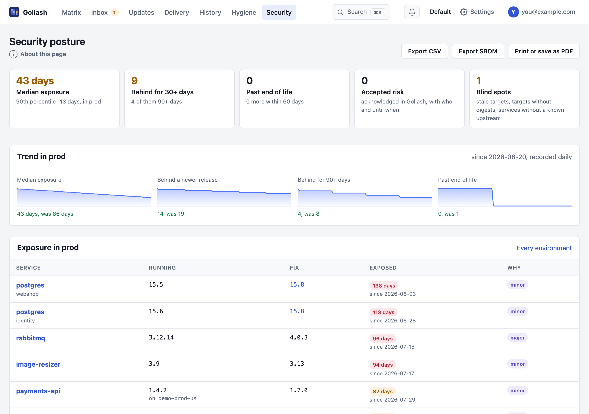
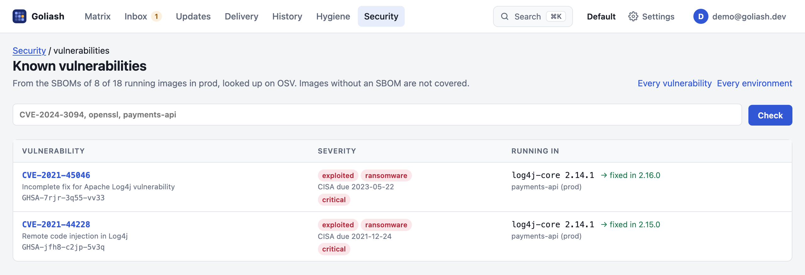
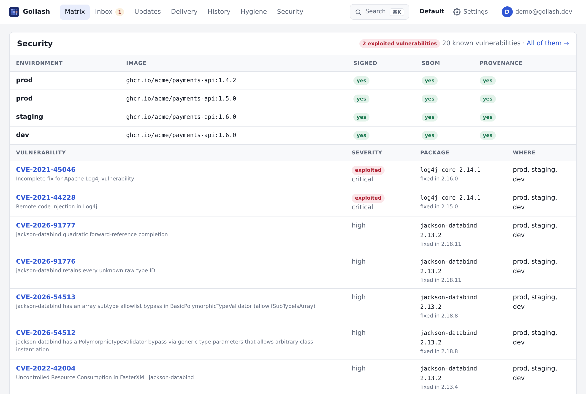

The **Security** page answers the questions a security officer asks about what runs, from the runtime itself rather
than from tickets or pipelines:



- **How long has production been exposed?** For every service behind a newer release, the time since the *first*
  newer release came out. The median and the 90th percentile summarise it, with the count behind for more than 30
  and 90 days.
- **What is new today?** *Since yesterday* opens the page with the [security brief](../notifications/#security-brief):
  releases found since yesterday that fix vulnerabilities in what runs, vulnerabilities CISA newly lists as
  exploited, upgrades past their [remediation deadline](#remediation-deadlines), upgrades fixing vulnerabilities
  still waiting and fixes merged but not deployed, each a link to where to act.
- **What is past its end of life?** Release cycles whose support has ended, or ends within 60 days
  ([endoflife.date](https://endoflife.date)).
- **What risk has been accepted?** Upgrades quieted with an acknowledgement count as accepted risk, with who
  acknowledged them and until when (on the service page).
- **Can the images be trusted?** Moving tags, tags pushed again, registries outside the allowed list and images
  without a known digest, from [image hygiene](../matrix/#image-hygiene).
- **Where are we blind?** Targets that stopped reporting, targets that report no digests, and services whose newest
  release is unknown, so their exposure cannot be measured.

The tiles are filters: *Behind for 30+ days*, *Past end of life* and *Accepted risk* show only those exposures
(*Show all* lifts it, and it stays when you switch between production and every environment), *Blind spots* jumps to
its section. Where a GitOps application deploys an exposed service, **Open PR** proposes the fix next to it.

## Security watches

An advance notice names software, not your services. **Security watches** on the Security page turns it into a
list: type what to watch (`php`, `openssl`, `ghcr.io/acme/api`), why and for how long (a week to three months, or
until removed), and each watch shows the services that run it, with the version and why they match: their name,
an image or workload they run, a GitOps application deploying them, or a package in their images' SBOMs. Updates
marks their upgrades *watch: php*; the `watch` notification announces their next release at once. Members start and
end watches; everyone sees them.

## Remediation deadlines

How long may an exploited vulnerability run? **Remediation deadlines** on the Security page set it per workspace,
in days, for three reasons to upgrade:

| Reason | The clock starts |
|---|---|
| Exploited vulnerability | when CISA listed it while the image ran there (or when the image started running, if later) |
| Security fix | when Goliash found the first release on the way that fixes vulnerabilities |
| End of life | on the end-of-life date of the running release cycle |

An upgrade with several reasons takes the earliest deadline. The `deadline` notification announces each upgrade
three days before its deadline and again the day it passes, once each (*postgres @ prod: the remediation deadline
for the end of life passed on 23 Oct; 13.4 runs, 13.16 fixes it*); a rule filtered by owner sends a team its own:

```sh
goliash notify create -channel team-data -events deadline -owners team-data -mode instant
```

An upgrade past its deadline for more than a week is no longer announced; the brief and the report name it. [Updates](../versions/#updates) marks each upgrade *due in
3 days* (amber within a week) or *overdue 5 days* (red), and a *past deadline* tile lists only those; the CSV has
`due` and `days_left`, `GET /api/v1/updates` has `due`, `due_for` and `days_left`. The panel counts what is past and
what is due within a week, and the [security brief](../notifications/#security-brief) and the
[posture report](../notifications/#security-posture-report) name the upgrades past their deadline. Admins set the
deadlines (none, 3 days to half a year each); with none set, Updates ranks by urgency alone. An acknowledged upgrade
(accepted risk) is not counted as past its deadline.

### Accepted risks

Putting off an update (Updates → *Put off*, or *Quiet notifications* on a service page) accepts its risk for a
while. Say **why** in the reason field: the reason goes into the audit log, the Security page's *Accepted risks*
panel and the [monthly report](#for-audits).

For audits that ask who decided, an admin ticks **Accepted risks need an admin's approval** under the deadlines.
Then a member's put-off:

- needs a reason;
- ends within 90 days at the latest (one until a version ends then too, if the version is not out by then);
- quiets nothing, and is not counted as accepted, until an admin approves it in the *Accepted risks* panel, or turns
  it down.

An admin's own put-off is approved at once. The `deadline` notification asks for the approval (*postgres @ prod:
dev@example.com accepts the risk until 31 Oct and waits for an admin's approval: "behind the VPN only"*) and, three
days before an accepted risk with a reason ends, says so, once each. Through the API, `POST /api/v1/acks` takes
`reason` and answers `pending`.

## Newest release unknown

A service whose newest release Goliash does not know cannot be measured: it shows as *unknown* in the tiles and
among the blind spots. Each says why, and what would let Goliash tell, on the Security page, the service's page,
its tile and the matrix (hover the note):

| Why | What to do |
|---|---|
| *not a version*: it runs `latest`, a branch or a commit | deploy a version tag; a moving tag is resolved when the registry lists the same image under a version tag |
| *check failed*: the registry refused or does not know the repository | registry credentials (server or agents), or the [upstream](/guide/versions/) it is published to |
| *checked by agent*: a private registry no agent has reported yet | credentials for the agents (`GOLIASH_CREDENTIAL_…`), or for the server |
| *no comparable tag*: none of the registry's tags reads like the running one (`1.4-custom`) | a **tag filter** in the version policy |
| *none in pinned major*: the policy pins a major with no release | change or remove the pin |
| *no registry image*: an image built where it runs | the repository it is published to, as the service's upstream |
| *not checked yet* | it is checked within minutes; or **Check now** |

## Base images

A service's own image is only as supported as the image it is built on: `node:18-alpine` reached its end of life in
April 2025 whatever the application's version. Goliash reads the base from the
`org.opencontainers.image.base.name` annotation or label, which BuildKit (`docker buildx`) records, when it reads
the image's source repository. The service page shows it under **Built on**, with its end of life from
[endoflife.date](https://endoflife.date), and the Security page lists every running service **built on an
unsupported base**: past its end of life, or within 60 days of it.

An image that does not declare its base can name it in the service's version policy (**Base image**, for example
`node:22-alpine`); `none` turns tracking off. The image is read on a public registry by the server; for private
images, set the base in the policy.

### Built on an outdated base

A new build is not always a fresh one: a build cache, or `FROM` without `--pull`, keeps the base's layers as they
were when the base was first pulled, with the vulnerabilities its newer builds fixed. The image's version and date
look current; its bottom layers are not.

Goliash checks this with the layers themselves. Building `FROM node:22-alpine` copies the base's layers unchanged,
so an image built on the base as its tag is now starts with exactly those layers. When it reads a running image's
evidence, Goliash also reads the base's tag (for the same platform, once per check) and compares:

- **current**: the image starts with the base's layers as they are now;
- **outdated**: it does not: it was built on an older build of the base (or on another base than it declares).

Outdated ones show as **Outdated base** on [Image hygiene](/guide/matrix/#image-hygiene), with when the base's current build was
made (*built on an older node:22-alpine than the one its tag has now (built Oct 2, 14 days ago): rebuild with
`--pull`*), in the Security page's supply chain, as an **older base** badge on the service's images, and in
`goliash_image_hygiene_findings{kind="outdated-base"}`. Bases pinned to a digest (`node@sha256:…`) are pinned on
purpose and left alone. Agents send the layers of private images (agent 1.61); the base itself must be readable by
the server, as public bases are.

### Chains of base images

Teams often build on their own base: the application is `FROM registry.example.com/base-java:21`, and that is
`FROM eclipse-temurin:21-jre-alpine`. The application can be built on `base-java:21` as it is now while
`base-java:21` itself was never rebuilt on the newer temurin, so temurin's fixes reach neither. Goliash follows the
chain down, up to four images deep:

- each image's base comes from its `org.opencontainers.image.base.name` label, or else from its BuildKit
  provenance attestation (`--provenance`, on by default with `docker buildx build --push`), which names every image
  the build used: Goliash takes the one whose layers, as they were at build time, the image starts with (a builder
  stage's image is not it);
- each link is compared like the first: current or outdated against its tag now;
- the chain stops at an official Docker image (`docker.io/library/…`, rebuilt by their maintainers on their bases),
  at an image whose base Goliash cannot tell or read, and four images down.

An outdated link anywhere makes the image's base outdated, and says which image to rebuild first: *built on
base-java:21, which is built on an older eclipse-temurin:21-jre-alpine than the one its tag has now: rebuild
base-java:21 with `--pull`, then this image*. The service page draws the chain under each image
(*on base-java:21 (current) → eclipse-temurin:21-jre-alpine (outdated)*), the Security page lists a base past its
end of life anywhere down the chain (*eclipse-temurin:17 under base-java:17*), and `GET /api/v1/services/{name}/images`
has `base_chain` and `rebuild_first`. Private bases are read with the workspace's
[registry credentials](/reference/collectors/#credentials-on-the-server); without them the chain stops there.

## Supply-chain evidence

For every image running in production, Goliash asks its registry what it holds beside the image:

- **Signed**: a [cosign](https://docs.sigstore.dev/cosign/) signature (`sha256-<digest>.sig`), a Sigstore bundle or a
  Notation signature as an OCI referrer.
- **SBOM**: an SPDX or CycloneDX attestation, as `docker buildx build --sbom=true` attaches it, or an SBOM artifact.
- **Provenance**: a SLSA provenance attestation (`--provenance=true`, GitHub artifact attestations).

The Security page shows the share of production images with each, and lists the unsigned ones. Goliash records that
these **exist**; it does not verify the signatures. Images on public registries are looked up by the server, at
most 40 per workspace and check, again after a week when something was found and after a day when nothing was.
Images on private registries are looked up by the agents, with the credentials they already use for private tags
(up to 20 digests per repository and round), and they send the packages of the SBOM along; this needs agent 1.27 or
newer. Images on Amazon ECR need the agent's role to have `ecr:GetAuthorizationToken`, `ecr:BatchGetImage` and
`ecr:GetDownloadUrlForLayer` (the CloudFormation and Terraform setups include them). Images without a known
digest count as *not checked*.

The same lookup reads the image's **size**: what pulling it downloads, its compressed layers and config, as
registries show it (linux/amd64, or the first platform, of a multi-platform image). A service's page lists it per
environment, with how much each differs from production (*76 MB +32 MB*): what promoting that version adds, and
**Image size** charts it per environment over the last 90 days, from the deploy history: each step is a deploy, so
a heavier base or a new dependency stands out. The metric `goliash_image_size_bytes` and the dashboards' *Images*
section show it in Grafana and SigNoz, next to each service's size budget, outdated bases and missing evidence. Under the chart, **Last change** lists what the latest deploy (production first) changed in
the image's layers: the new ones and the gone ones, biggest first, with the Dockerfile step that made each, read from
the image config's history (`RUN apt-get install -y chromium`, +145 MB). Layers both versions share, the base and
unchanged steps, are left out: what is listed is what grew. Agents read it for private images from agent 1.61.
`goliash images SERVICE` shows the same in a terminal.

### Who signed it

A keyless signature (`cosign sign` in CI, GitHub artifact attestations, Chainguard and many official images) carries
a short-lived certificate from Sigstore's Fulcio naming who signed: the CI workflow
(`https://github.com/acme/api/.github/workflows/release.yml@refs/heads/main`), a service account or a person's email,
and the identity provider that vouched for it (GitHub Actions, GitLab, Google). Goliash reads it from cosign's
signature and from Sigstore bundles, for public images and, from agent 1.70, for private ones:

- each service's **Security** panel shows who signed each running image;
- the Security page lists **Signed by**: every signer of production images and how many images each signed, so a
  person's email among workflows stands out;
- a service's version policy can name its **expected signer**, exactly or as a prefix (`https://github.com/acme/*`);
  an image that is not signed by it (unsigned, signed by someone else, or signed with a key that names nobody)
  shows as *unexpected signer* on [Image hygiene](/guide/matrix/#image-hygiene).

Goliash reads the identity as the certificate states it; it does not check the certificate's chain to Fulcio or the
signature itself. Use `cosign verify --certificate-identity … --certificate-oidc-issuer …` (or a policy controller
in the cluster) to enforce it; Goliash shows whether what runs matches what you expect.

## Is it running?

**Security → Is it running?** answers "is CVE-2024-3094 in production?" in seconds, and lists every known
vulnerability of the running images:



1. For images whose registry holds an SBOM (a BuildKit or cosign attestation, or an OCI referrer, see
   [SBOM of what runs](../sbom/#where-the-packages-come-from)), Goliash reads its package list once: package URLs
   such as `pkg:deb/debian/openssl@3.0.11-1~deb12u2` or `pkg:npm/lodash@4.17.15`.
2. It asks [OSV](https://osv.dev) which known vulnerabilities affect those packages, again every day, and reads
   each advisory once for its CVE aliases, summary and severity. Debian, Ubuntu and Alpine packages are asked about
   in their distribution release, Wolfi and Chainguard packages under their source package (Chainguard's own
   advisories), language packages (npm, PyPI, Go, Maven, crates, RubyGems, NuGet …) by their package URL.
3. Search by CVE or advisory ID, package or service. A vulnerability shows once, under its CVE, with every advisory
   that names it (`DEBIAN-CVE-…`, `DSA-…`, `GHSA-…`) and each package and service it is in.

**What to patch first.** Vulnerabilities in CISA's catalog of
[known exploited vulnerabilities](https://www.cisa.gov/known-exploited-vulnerabilities-catalog) (KEV) come first,
marked *exploited* with CISA's due date and *ransomware* when CISA knows of ransomware using them; *Only exploited
in the wild* shows just those. Each affected package says the version that fixes it (the lowest above the running
one, from OSV), or *no fix yet*. The catalog is read once a day; `GOLIASH_KEV_URL` names a mirror or turns it off.

**How long it has run.** Each vulnerability says how long it has been running (*running for 23 days*: since the
first affected image started), and an exploited one still running after the date CISA set for fixing it
([BOD 22-01](https://www.cisa.gov/binding-operational-directive-22-01)) is marked *past due*; the Security page counts
them. `GET /api/v1/vulnerabilities` has `running_since`, `exploited.past_due` and `since` per affected image.



Each service's page has a **Security** panel too: its running images per environment, signed or not, with an SBOM
and provenance or not, and the vulnerabilities in them, exploited ones first, each with the package and the version
that fixes it.

A cell of the matrix whose running image has a vulnerability exploited in the wild shows it as a red
*exploited CVE-…* badge (its tile needs attention), and [Updates](../versions/#updates) puts that upgrade first.

A notification rule with the `vulnerability` event announces each exploited or critical vulnerability as it starts
running ([Notifications](../notifications/#vulnerabilities)).

**Export CSV** on the vulnerabilities page downloads what it shows (all of it, not only the first 300), one row per
vulnerability and affected image, with CISA's exploited flag and due date, whether it is past due, the fix and since
when it runs there: for an audit, or to import into a ticket system. `GET /api/v1/vulnerabilities?format=csv` gives
the same. Cells that start like a formula are quoted, so a package name cannot run in a spreadsheet.

The answer covers only images with an SBOM Goliash could read, and the page says how many those are. While
advisories are still being looked up it says so, and does not answer "not running".

Only package names and versions are sent to OSV, never image, service or host names. `GOLIASH_OSV_URL` points the
lookups at a mirror, or turns them off (`off`).

**Products built into their image.** PostgreSQL, nginx, Redis, Keycloak and most official images build the product
from source, so it is in no package database and often only loosely in an SBOM. Goliash looks up the running
version of the product itself, from the best source there is:

1. **the project's own GitHub security advisories**, when its repository publishes any (Redis, Keycloak, Grafana,
   Traefik, Caddy, Envoy, Argo CD, RabbitMQ, NATS, CoreDNS, Prometheus…): the affected versions and the fix as the
   authors write them, read every 6 hours. Ranges are read as projects write them (`< 26.4.14`, `>= v3.0.0, <=
   v3.7.15`, `All` with a fix per release line); an advisory without a fix and without an upper bound counts for
   half a year after it is published. Then NVD is not asked about that product;
2. **[NVD](https://nvd.nist.gov)** for the others (PostgreSQL, nginx, PHP, Vault…), by the catalog's `cpe` or the
   version policy's, once a day per product version: `postgres:16.2-alpine` is PostgreSQL 16.2, and a moving tag
(`postgres:16`) counts by the version its digest resolved to. Each CVE comes with its severity (NVD's own CVSS
score first) and the first fixed version of its range (*postgresql 16.2, fixed in 16.3*), next to the SBOM's
findings: the same CVE from both is one finding, CISA's exploited list applies to it, and a critical or exploited
one sends the `vulnerability` alert. Without an [API key](/reference/configuration/) NVD answers 5 requests in 30
seconds, so Goliash asks for 8 product versions per check; `GOLIASH_NVD=off` stops it.


## Exposed to the outside

An exploited vulnerability in an internal batch job and the same one behind the shop's ingress are not equally
urgent. Agents report how each workload can be reached from outside its cluster or host: an Ingress or HTTPRoute
host, a LoadBalancer or NodePort service, an ECS load balancer or public IP, a Lambda function URL without
authentication, a Docker port published on every interface (details and permissions in
[Collectors](../../reference/collectors/#exposure)).

- **Updates** marks such an upgrade **exposed** (hover for the ways in) and puts it first within its urgency: an
  exploited vulnerability behind an ingress before one in an internal service, then production first as before.
- **Vulnerabilities** puts findings in exposed images right after those exploited in the wild, marks them, and
  **Only exposed** narrows the list (`?exposed=1`; the CSV and `GET /api/v1/vulnerabilities?exposed=true` too).
- The CSV exports and the API (`exposed` on updates and on each affected image) say how.

What the agent reads is a hint, not a scan: a load balancer may be internal, a firewall may close a port. Label a
workload `goliash.exposed=internal` (or `internet`) where you know better.

## Verify images in CI

Everything above looks at what already runs. `goliash verify` looks before: a step in the pipeline that fails
when the image about to be deployed

- carries a vulnerability CISA lists as **exploited** in the wild,
- is on a release cycle past its **end of life**,
- or is **not signed** as its service's policy wants (`signer` in the version policy): unsigned, or signed by
  someone else.

```sh
GOLIASH_URL=https://goliash.example.com GOLIASH_TOKEN=glsh_api_… goliash verify ghcr.io/acme/payments-api:1.6.0
```

```
ghcr.io/acme/payments-api:1.6.0 (sha256:3f1c…): blocked
  BLOCK exploited: exploited in the wild (CISA KEV): CVE-2021-44228
  warn  critical: 2 critical vulnerabilities: CVE-2024-0001, CVE-2024-0002
  412 packages (SBOM: attestation), signed by https://github.com/acme/payments-api/.github/workflows/release.yml@refs/heads/main; policy of payments-api
```

The exit code is 1 when the image breaks a blocking rule, and 0 when it passes; warnings do not fail it.

- **Where the packages come from.** `-sbom sbom.cdx.json` hands in the SPDX or CycloneDX JSON the build made (syft,
  docker buildx `--sbom`, Trivy). Without it, the server reads the image's SBOM attestation, or its package
  database, from the registry with the workspace's registry credentials.
- **Which rules block.** `-fail-on` chooses: `exploited`, `eol`, `signer`, `unsigned`, `critical`, `no-sbom`,
  `unreadable`, or `none`. The default is `exploited,eol,signer,unsigned`.
- **Policy and output.** `-service` names the service whose policy applies; by default it is the one already
  running the image's repository. `-json` prints the verdict for other tools.
- **Token and audit.** The token can be a *viewer* API token. Each check is in the audit log as `image.check`.
  The API is `POST /api/v1/check`.

GitHub Actions, after the image is pushed:

```yaml
- name: Verify the image with Goliash
  run: |
    docker run --rm -e GOLIASH_URL -e GOLIASH_TOKEN -v "$PWD:/w" ghcr.io/pipozzz/goliash:latest \
      verify -sbom /w/sbom.cdx.json ghcr.io/acme/payments-api:${{ github.sha }}
  env:
    GOLIASH_URL: https://goliash.example.com
    GOLIASH_TOKEN: ${{ secrets.GOLIASH_TOKEN }}
```

GitLab CI, with the release's binary (the server image has no shell to run a script in):

```yaml
verify:
  image: alpine:3.20
  script:
    - V=1.151.0 # your server's version
    - wget -qO- https://github.com/pipozzz/goliash/releases/download/v$V/goliash_${V}_linux_amd64.tar.gz | tar xz goliash
    - ./goliash verify "$CI_REGISTRY_IMAGE:$CI_COMMIT_SHA"
```

## Exploited, no fix yet

Sometimes CISA lists a vulnerability as exploited in the wild before any fixed version exists, so there is no
upgrade to make. Until there is, a **mitigation** keeps it from being used: a WAF or proxy rule, a feature or
setting turned off, the service cut off from the network.

- **Where it shows.** The Security page's **Exploited, no fix yet** panel and the vulnerabilities list (*no fix*)
  show where such a vulnerability runs, and whether each place is mitigated.
- **Recording one.** **Record a mitigation** (members) takes the place (service and environment), what kind it
  is, what was done, and when to review it (2 weeks, 30 or 90 days). It is in the audit log, and the monthly
  report lists mitigations.
- **The deadline.** With remediation deadlines set, the deadline for an exploited vulnerability is the date to
  mitigate by: from when CISA listed it while it ran.
- **Notifications.** The `deadline` notification says, once, where production runs one without a mitigation,
  and three days before a mitigation's review.
- **When a fix comes out**, Goliash closes the mitigation and says so (*a fix for CVE-… is out; upgrade now*). From
  then on the upgrade is on Updates with its deadline, like any other. A mitigation also closes when the
  vulnerable image no longer runs, and a member can withdraw one.

## Not affected

A scanner matches packages against advisories, and sometimes the advisory does not fit what runs. A common case:
an image ships `nginx 1.27.1-1~bookworm` from nginx.org, which is matched against Debian's advisory for
CVE-2023-44487 (*no fix yet* there), while nginx itself fixed it in 1.25.3. When you know a vulnerability does not
affect a service, say so instead of leaving it open:

- **Marking one.** On the service's page, **Not affected?** under the vulnerability (admins) takes the reason (after
  VEX's justifications: already fixed in the version that runs, the component is not in the image, the vulnerable
  code is never reached, the software prevents it another way, or other), a sentence on how you know, and when to
  review it (90 days by default).
- **What it changes.** The vulnerability leaves that service's findings everywhere: the vulnerabilities page,
  alerts, remediation deadlines, Security and the API. Other services that have it still count it. The service's
  page lists it under **Not affected**, with the reason, and the monthly report has a **Not affected** section for
  auditors.
- **Withdraw** (admins) puts it back.

### VEX from the image's publisher

An image can carry an [OpenVEX](https://openvex.dev) document in which its publisher says which vulnerabilities its
packages match but do not affect it: Docker Hardened Images and Chainguard ship them, and your own builds can too:

```sh
# with the build
docker buildx build --attest type=vex,filename=app.vex.json --push -t ghcr.io/acme/app:1.4.0 .
# for an image already pushed
cosign attest --type openvex --predicate app.vex.json ghcr.io/acme/app@sha256:…
```

Goliash reads it beside the SBOM (BuildKit attestations, cosign's `.att` tag, OCI referrers; agents read it for
private registries) and refreshes it daily. A statement that a vulnerability is `not_affected` or `fixed`, for the
whole image or for the package it matched, leaves that package out of the findings and lists it under **Not
affected** with its justification and author (*the vulnerable code is never run, says Acme Security (VEX)*).
Supply-chain evidence shows *vex* among what was found.

### Kernel packages

An image often carries the kernel's packages without running them: `linux-libc-dev` comes with build-essential,
`kernel-headers` with gcc on Red Hat-like images. Every kernel CVE matches them, but a container runs on its host's
kernel, so Goliash leaves them out of the image's findings and lists them, grouped, under **Not affected** (*a kernel
package in the image*). The host's kernel is patched with the nodes; dropping those packages from the final stage of
the build makes the SBOM smaller too.

### Upstream fixes

For that common case Goliash does not wait for you. When a distribution's advisory has no fix for a package whose
upstream product Goliash knows (nginx, OpenSSL, curl, PostgreSQL, Redis and others), it asks NVD for the versions
the CVE affects upstream (exploited and serious ones first; `GOLIASH_NVD_API_KEY` makes it faster) and reads the
version that runs without the distribution's revision (`1.27.1-1~bookworm` is nginx 1.27.1):

- **Past upstream's fix:** the package leaves the findings, and the service's page lists it under **Not affected**
  as *Goliash, from NVD*, with the ranges, as does the monthly report. Where NVD only says the last affected
  version (*up to 1.25.2*) rather than the fixed one, this needs a later release line (1.27 is, 1.25.4 is not):
  NVD may have closed such a range at the newest release of its time, before there was a fix.
- **Still in upstream's range:** instead of *no fix yet* it says which version fixes it (*upstream nginx fixed it
  in 1.25.3*), and "What to do" says to run that version or newer, from upstream's own packages or image when the
  distribution has none. An exploited vulnerability with an upstream fix asks for the upgrade, not a mitigation.

## Images without an SBOM

Goliash knows an image's vulnerabilities from the packages it contains. It takes them from the first of:

1. **the image's SBOM**: the SPDX or CycloneDX attestation `docker buildx build --sbom=true` attaches (official
   images have one), a cosign attestation, or an SBOM pushed as an OCI referrer. It lists the operating system's
   packages and the application's own dependencies (npm, Composer, Maven, Go modules…);
2. **the image's package database**, when it has no SBOM: Goliash reads the layers, newest first, for
   `/var/lib/dpkg/status` (Debian and Ubuntu; distroless images' `/var/lib/dpkg/status.d`) or
   `/lib/apk/db/installed` (Alpine, Wolfi, Chainguard), and `/etc/os-release`. An image built `FROM ubuntu:22.04`
   with `apt-get install nginx php8.1-fpm` is checked against Ubuntu's own advisories, which know Ubuntu's patched
   builds: `nginx 1.18.0-6ubuntu14.4` is not taken for an old upstream 1.18. This covers the system packages only,
   not the application's dependencies. Images up to 1 GB of layers (gzip or plain), two per check, are read once
   per digest; private images are read with the workspace's
   [registry credentials](/reference/collectors/#credentials-on-the-server), or by the agents (1.141 and later)
   for registries only they reach.

What neither covers, Goliash does not know by itself: software built from source or copied into the image, RPM-based
images (Red Hat, Rocky, Amazon Linux), scratch images. **Declare** what you built into the image with a label, and
Goliash looks up its CVEs in NVD by version, like [the products of known images](#is-it-running):

```dockerfile
LABEL dev.goliash.components="nginx=1.27.2, php=8.3.12, openssl=3.3.2"
```

Usual names are known (nginx, php, openssl, node, python, ruby, go, postgresql, redis, haproxy, curl, httpd, tomcat,
openjdk, imagemagick, ffmpeg, git, sqlite, zlib, libxml2, mariadb, mysql, memcached, caddy, traefik, envoy,
keycloak, grafana); anything else by its NVD product, `vendor:product=version`
(`apache:http_server=2.4.62`). A build argument keeps it in step with the build: `ARG NGINX_VERSION` …
`LABEL dev.goliash.components="nginx=${NGINX_VERSION}"`. The label is read with the image's evidence, by the
server or, for registries only they reach, by the agents (1.141 and later). The Security page lists production's images without an SBOM, why
(*no package database*, *not read yet*), and how to add one to the build, ready to copy:

```yaml
# GitHub Actions: the build-push step
- uses: docker/build-push-action@v6
  with:
    push: true
    sbom: true              # an SPDX SBOM of every package in the image, attached to it
    provenance: mode=max    # what it was built from, including its base images
```

```sh
# GitLab CI or anywhere else with BuildKit
docker buildx build --push --sbom=true --provenance=mode=max -t registry.example.com/team/app:1.2.3 .

# an image already pushed, without rebuilding it
syft registry.example.com/team/app:1.2.3 -o spdx-json > sbom.spdx.json
cosign attest --yes --type spdxjson --predicate sbom.spdx.json registry.example.com/team/app:1.2.3
```

At its next deploy (or check), Goliash reads the SBOM from the registry, and it replaces the package list read from
the image.

## Licenses

The same SBOMs say which license each package is under. **Security → Licenses** sorts the packages of running
images by what their licenses ask, most demanding first:

| Class | Examples | What it asks |
| --- | --- | --- |
| Network copyleft | AGPL, SSPL, OSL | offering the software as a service can oblige you to publish your source |
| Source-available | BUSL, Elastic, PolyForm, non-commercial | limits on production, commercial or competing use |
| Strong copyleft | GPL, EUPL | shipping it with your code can oblige you to publish that code |
| Weak copyleft | LGPL, MPL, EPL | changes to the package itself must be shared |
| Unknown | | the SBOM names no license, or one Goliash does not know |
| Permissive | MIT, Apache, BSD | attribution only |

The page opens on the packages that **need a look** (network copyleft, source-available, strong copyleft and unknown),
each with the services and environments it runs in. An expression with OR counts as its least demanding choice
(`MIT OR GPL-2.0` is permissive); one with AND as its most demanding part. Operating system packages (Debian,
Alpine, RPM) are left out unless asked for: copyleft is the norm there (glibc, bash) and comes with the base image.

**Export CSV** on the page downloads what it shows, one row per package and where it runs, for a license review;
`GET /api/v1/licenses?format=csv` gives the same. The same list is `GET /api/v1/licenses` (`?class=attention`, `?environment=prod`, `?os=false`, `?q=AGPL`), the
In a terminal, `goliash licenses` lists the same, and `-fail-on network-copyleft,source-available` exits with 1 when
such a package runs, for a check in cron or CI:

```sh
goliash licenses -environment prod -fail-on network-copyleft,source-available
```

`licenses` tool for AI assistants and Goli, the metric `goliash_license_packages{class,kind}`, and licenses per
package in the [CycloneDX inventory](../sbom/). Goliash reads licenses as the SBOMs declare them: it is a map, not
legal advice.

## Time to patch, and patching by team

Every upgrade deployed to production closes an exposure: from when the first release after the old version came out
(its publication date, else when Goliash found it) to the deploy. Those days are the **time to patch**.
**Time to patch in prod** draws it month by month for the last six months, the median and the 90th percentile, with
how many upgrades each month had; rollbacks and staging do not count, and a version deployed to several targets
counts once.

**Patching by team** sums production up per team (a service's owner): services in production, how many run behind
a newer release and for how long (median), how many upgrades are past their deadline, how many were deployed in the
last 90 days and their median time to patch, with bars for the last six months. The slowest come first: most past
their deadline, then longest behind; each team links to its Updates. The same numbers are
[metrics](/guide/observability/) by owner for a team's dashboard (*Patching by team* in the Grafana and SigNoz
dashboards), the weekly report names the slowest teams, and a team's own rule sends it
[its week](/guide/notifications/#security-posture-report).

## Trend

Goliash records production's posture every hour (the day's last reading stays) and keeps a little over a year of
it. Under the tiles, **Trend** draws the last 90 days of the median exposure, how many services run behind a newer
release, how many for 90+ days and how many past end of life, each with where it started: green when it went down.
The [weekly report](../notifications/#security-posture-report) adds the numbers from a week before, and
`GET /api/v1/posture` returns them once a week as `history`, so [Goli](../goli/) can answer "is patching getting
faster?".

## How exposure is counted

Exposure starts when the first release newer than the running one was **published** (GitHub or GitLab release
dates). When a release's date is unknown, Goliash counts from when it first saw the release and shows the number as
a lower bound (`≥ 12 days`); such rows are left out of the median and the percentile. A service running several
versions in one environment counts with its oldest, the one an upgrade has to reach, and names the targets running
it.

The page shows the last environment (production) by default; *Every environment* lists all of them.

## For audits

- **Monthly report** (`/security/report`, also in the command palette) is one month of vulnerability management,
  made to hand to an auditor for NIS2 (Article 21), ISO 27001 (A.8.8), SOC 2 (CC7.1) or DORA: the remediation
  deadlines in force, production's posture at the month's end, every upgrade deployed with its time to patch and
  whether its security fix met the deadline (the *security fixes in time* share), each team's month, what runs
  exploited or past its deadline as the report is made, the accepted risks with who accepted them and until when,
  and how each number is counted. Arrows move between months; **Export CSV** gives the month's upgrades and **Print
  or save as PDF** the whole report. The month-end posture needs Goliash to have run then: it is read from the daily
  trend samples.
- **Export CSV** gives every exposure with its service, application, environment, targets, running version, the
  version to move to, the exposure date and days, whether the date is known, end of life, accepted risk and the
  release notes link: a ready start for a risk register.
- **Export SBOM** gives a CycloneDX 1.6 bill of materials of everything that runs, with the packages of each
  image's SBOM nested inside: for Dependency-Track, a vendor questionnaire or the software inventory NIS2 and the
  Cyber Resilience Act ask for.
- **Dependency-Track**: Integrations → Dependency-Track gives a script for cron or a scheduled CI job that uploads
  one project per environment (`goliash prod`, version `running`) from
  `/api/v1/inventory?format=cyclonedx&environment=…`. Its API key needs `BOM_UPLOAD` and `PROJECT_CREATION_UPLOAD`;
  the default *Automation* team lacks the second, and the upload answers 401 without it.
- **Print or save as PDF** prints the page with the time it was generated, as evidence of patch management for
  frameworks that ask for it (NIS2, DORA, SOC 2, ISO 27001).

- **Weekly report**: a notification rule with the *security posture report* event sends these numbers and the
  longest exposures every Monday (or day) to Slack, Teams, e-mail or any channel. See
  [Notifications](../notifications/#security-posture-report).
- **Trends and alerts**: `/metrics` serves the posture (`goliash_exposure_median_days`, `goliash_exposure_p90_days`,
  `goliash_exposures`, `goliash_end_of_life`, `goliash_accepted_risk`, `goliash_exposure_days`), the Grafana and SigNoz
  dashboards chart it over time (is patching getting faster?), and the Prometheus rules alert on production past its
  end of life and on 90+ days behind. See [Grafana dashboard](../grafana/) and [SigNoz dashboard](../signoz/).

The same data is available from the REST API (`GET /api/v1/posture`, for GRC tools and risk registers; see the
[API reference](../../reference/api/)), to AI assistants over [MCP](../../reference/mcp/) (`posture`), and to
[Goli](../goli/): **Explain** on every exposure asks what the releases in between fix and what to do first.
