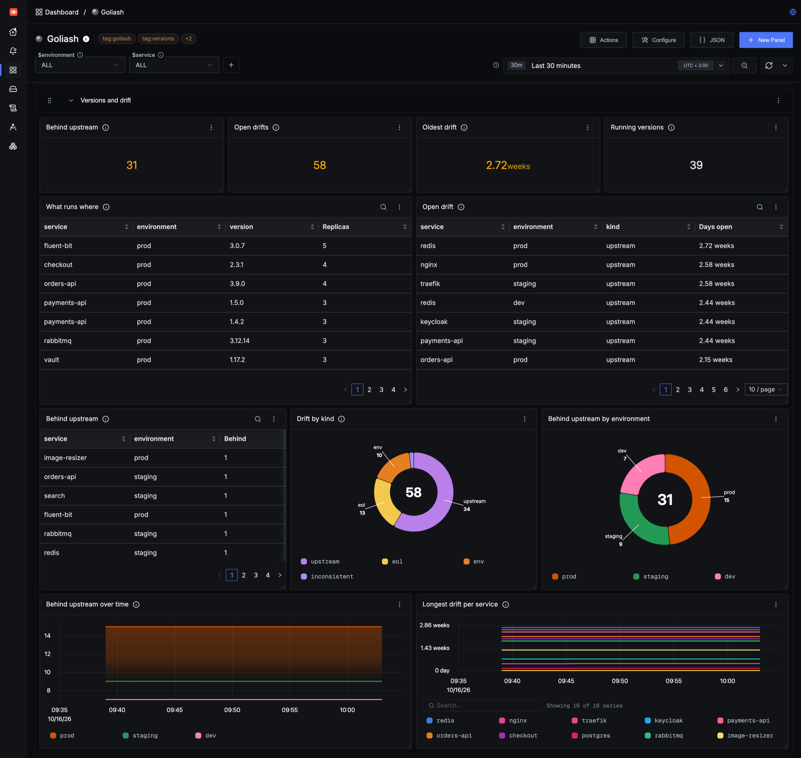
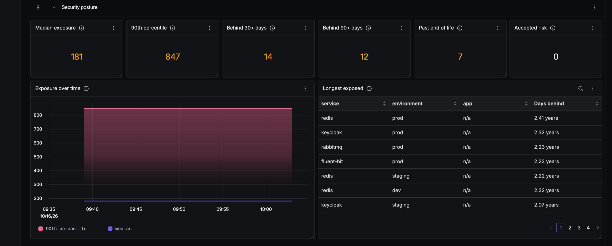

Goliash serves what runs where, drift, delivery speed, security posture and its own health at `/metrics`. The
OpenTelemetry Collector that already sends to SigNoz can scrape it, and a ready-made dashboard shows it next to your
traces, logs and service metrics.



The quickest way is **Settings → Integrations** in Goliash: it creates a viewer token with one click and shows the
collector settings filled in for your server, next to a download link for the dashboard. The steps below do the same
by hand.

## 1. A token for the collector

`/metrics` needs an API token with the viewer role. Create one under **Users → API tokens**, or:

```sh
goliash token create -name signoz -role viewer
```

Save the `glsh_api_…` value in a file and mount it into the collector container, e.g. as
`/etc/otelcol/goliash-token`.

## 2. Scrape Goliash with the OpenTelemetry Collector

Add a Prometheus receiver to the collector that sends to SigNoz, in its own pipeline:

```yaml
receivers:
  prometheus/goliash:
    config:
      scrape_configs:
        - job_name: goliash
          scrape_interval: 60s
          scheme: https
          authorization:
            credentials_file: /etc/otelcol/goliash-token
          static_configs:
            - targets: [goliash.example.com]

service:
  pipelines:
    metrics/goliash:
      receivers: [prometheus/goliash]
      processors: [batch]
      exporters: [otlp]   # the exporter your SigNoz collector already uses
```

Where this goes depends on how SigNoz runs:

- **Docker (Foundry):** the ingester's configuration, `pours/deployment/ingester/ingester.yaml`. Set it through
  `config.data` in `casting.yaml`, since `foundryctl forge` writes `pours/` again, and add the token file to the
  ingester's volumes. On the older Docker Compose install it is `otel-collector-config.yaml`.
- **Kubernetes (Helm):** `otelCollector.config` in the Helm values, with the token from a secret mounted into the
  collector.
- **SigNoz Cloud:** run a collector of your own with the ingestion key, or add the receiver to the one you already
  run.

The metrics keep their Prometheus names and labels, so the queries in [Metrics and alerts](../observability/#metrics)
work as they are.

## 3. Import the dashboard

Download [`deploy/signoz/goliash-dashboard.json`](https://github.com/pipozzz/goliash/blob/main/deploy/signoz/goliash-dashboard.json),
then in SigNoz open **Dashboards → New dashboard → Import JSON** and upload or paste it. The *environment* and
*service* variables at the top apply to every panel.

- **Versions and drift:** services behind upstream, open drifts and the oldest, what runs where, services running
  more than one version.
- **Delivery (last 30 days):** deploys, rollbacks, the median and slowest lead time from one environment to the next, deploys
  per service and the lead time table. Lead time needs at least two environments; with only one, its panels stay
  empty and SigNoz says it cannot find `goliash_lead_time_seconds`.
- **Security posture:** how long production has run behind available releases (median and 90th percentile, and
  over time: is patching getting faster?), services behind for 30 and 90 days, past end of life, accepted risk, and
  the longest exposed services, and packages by license class (copyleft, source-available and unknown ones that
  need a look).
- **Image hygiene:** moving tags, tags pushed again, untrusted registries, outdated bases, sizes over budget and
  images without a digest.
- **Images:** what pulling each service's image downloads over time and against its size budget, bases with a newer
  build than the image is built on, images missing a signature, SBOM or provenance, and layer counts.
- **Goliash itself:** agents online and stale, snapshots waiting, failing notifications, the server running the
  background work and the running version.



## 4. Deploys next to your services

SigNoz has no annotations. Put the *Deploys per service* panel next to your service's latency or error panels, so a
spike lines up with the deploy that may have caused it, or alert on new versions (below).

## 5. Alerts

The queries in [Metrics and alerts](../observability/#alerts) work in SigNoz alerts as they are: create an alert
with a PromQL query, for example `sum(goliash_outdated{environment="prod"}) > 0` for production behind upstream, or
`goliash_end_of_life{state="passed"} > 0` for production past end of life.

Alerts about versions themselves (new releases, drift, removed services) are better sent by Goliash directly; see
[Notifications](../notifications/).

Using Grafana instead? See [Grafana dashboard](../grafana/).
