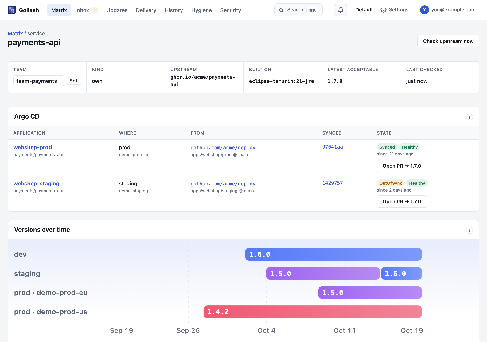
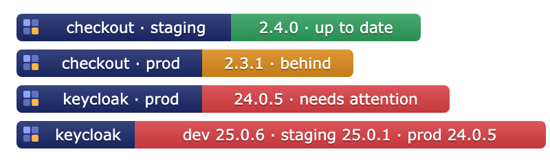
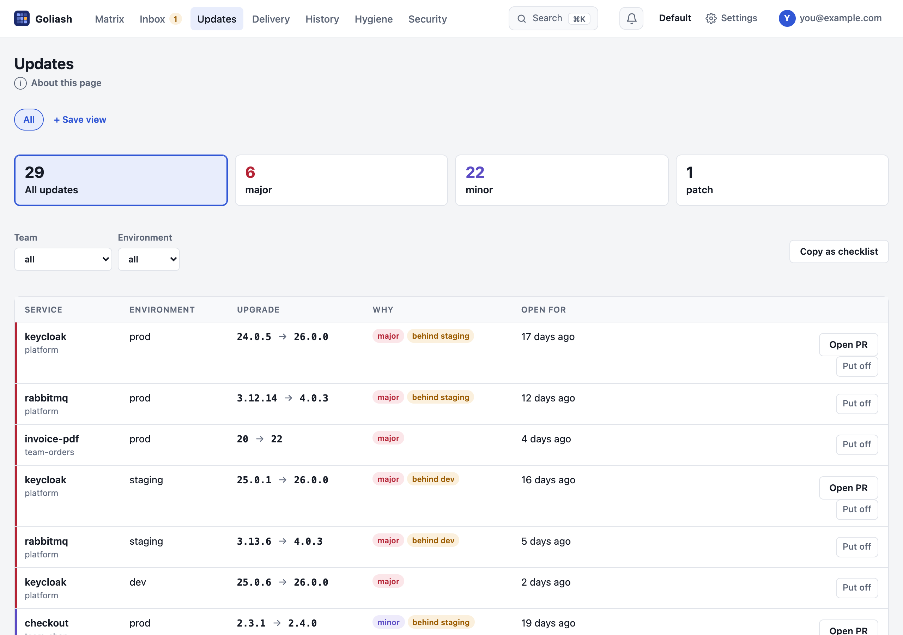
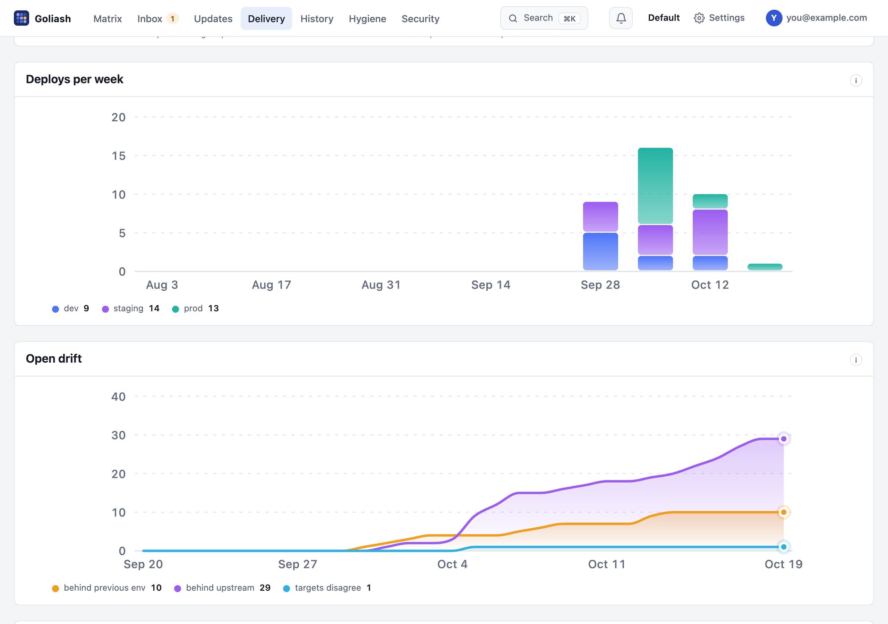

## Where upstream versions come from

For each service, Goliash picks an **upstream repository**: the one set on the service, else the image its main
containers run. It lists that repository's tags and keeps the newest versions the policy accepts as releases.

- **Public registries** are checked by the server: Docker Hub, GHCR, Quay, registry.k8s.io, gcr.io,
  public.ecr.aws, mcr.microsoft.com, registry.gitlab.com, docker.elastic.co, registry.access.redhat.com and cgr.dev.
- **Private registries**, and private repositories on the public ones, are checked by the server when an admin
  gives it read access under **Settings → Private registries**, else by the agents with credentials from their own
  environment: a configured credential, `docker login`, or Kubernetes pull secrets. See
  [Collectors](/reference/collectors/#private-registries).

New services are checked within a minute, then every hour. **Check now** on a service page, or `goliash check`,
checks at once; the button also reads the workspace's images again and asks OSV about their packages in the
background, so a patched image just deployed shows what it fixed within minutes rather than at the next hourly run.



## Moving tags

Tags such as `1`, `18-alpine` or `latest` move: they point at whatever release was pushed last. The image that runs
has a digest, though, and the server compares it with the digests of the tags it could be (`1.27.3`, `1.27.2`, …,
newest first). The match shows next to the tag, as **1 = 1.27.3**, and from then on drift and upstream releases
are compared with that exact version: `1 = 1.27.3` is behind `28.0.0`, not "1 behind 28".

Each digest is looked up once (a digest never changes); a digest no tag matches is tried again a day later. The
lookups use `HEAD` requests, which Docker Hub does not count against its pull limit, and read full manifests only
for the two newest candidates when the runtime recorded a platform's digest instead of the index's. This needs the
digest the image runs with: Kubernetes, Docker, Swarm and Nomad report it; Compose files from Git do not. For
images on private registries the agents do the lookup with their credentials, after their next registry check.

## Badges

A service's page offers badges for a README, a wiki or a status page: the running version and its state, in the
state's colour, for one environment or for all of them.



**Copy markdown** next to a badge gives a link that opens the service in Goliash:

```markdown
[](https://goliash.example.com/services/checkout)
```

Badges load without signing in, so GitHub and wikis can show them; they refresh within five minutes. Each address is
signed for its service and environment, so nobody can make one up for another service. Members and up see the badge
addresses. `goliash badges reset` makes a new signing key: every badge handed out stops loading, and the service pages
offer new ones.

## Own or third-party

A service is *third-party* when its image is someone else's software: one of Docker Hub's official images
(`docker.io/library/postgres`) or an image of the [catalog](#version-policy); anything else is taken as your team's
*own*. The service page shows it under **Kind**; its form can set it either way, or back to *from the image*.

## Version policy

A policy decides which tags count as versions and which differences are worth an alert. Set it on the service
page, with `goliash service set`, or through the catalog.

| Field | Meaning | Default |
| --- | --- | --- |
| `track` | The smallest jump worth an alert: `patch`, `minor` or `major`. | `patch` |
| `pin_major` | Stay on this major: newer majors are shown, not alerted. | none |
| `tag_filter` | A regular expression tags must match. | tags shaped like the running one |
| `major_filter` | A regular expression a release's major version must match, tags still compared like with like: `[02468]$` keeps to even majors. | from catalog (Node.js: even, long-term support majors; Eclipse Temurin: Java's LTS releases; .NET: even majors; Ubuntu keeps to LTS releases with a `tag_filter`) |
| `prerelease` | Consider alpha, beta and rc versions. | `false` |
| `auto_pr` | Per environment, the biggest jump Goliash opens a pull request for by itself, in the repository its [Argo CD or Flux](/guide/argocd/#automatic-pull-requests) application deploys from: `{"dev": "minor"}`. | none |
| `drift_alert_after` | How long drift lasts before it is announced, per kind, e.g. `{"env": "72h"}`. | see below |
| `github`, `github_tag_prefix` | GitHub repository (`owner/repo`) whose releases give dates and release notes. | from catalog or image label |
| `gitlab` | GitLab project (`gitlab.com/group/project`) whose releases give dates and release notes; `github_tag_prefix` applies too. | from catalog or image label |
| `changelog` | A release notes URL template with `{version}`. | none |
| `cpe` | The product in [NVD](https://nvd.nist.gov), as CPE `vendor:product` (a list): its CVEs are looked up by the running version, for software built into the image that no SBOM or package database lists. See [Is it running?](/guide/security/#is-it-running) | from catalog (`postgresql:postgresql` for `postgres`) |
| `security` | Where the project says which releases fix vulnerabilities, when its release notes do not: `php.net`, `go.dev`, or `eol-phase` (every release of a cycle in security-fixes-only support). Releases whose GitHub or GitLab notes name a CVE, GHSA or GO id (or say *security release*) are known without it. See [Security releases](/guide/notifications/#security-releases). | from catalog (`php`) |
| `base_image` | The image the service's image is built `FROM`, when it does not declare it; `none` turns base tracking off. | as the image declares |
| `max_size_mb` | The image size budget in MB: over it, Image hygiene lists it and `image_over_budget` alerts. | none |
| `signer` | Who should sign its images: a keyless signature's identity (`https://github.com/acme/api/.github/workflows/release.yml@refs/heads/main`), or a prefix ending in `*` (`https://github.com/acme/*`). Otherwise Image hygiene lists it as *unexpected signer*. | none |

Without a `tag_filter`, tags are compared **like with like**: a service running `1.27.2-alpine` is compared with
other `-alpine` tags with three version parts, so `latest`, `mainline` or `1.27-bookworm` do not count. A tag that is no
version names a flavour: `alpine` is compared with the newest `8.2.1-alpine`, `pg18` with `0.8.1-pg18`, while
`latest` or `stable` are compared with plain releases. Tags such as `-testing`, `-unstable` or `-insiders` count as
prereleases.

```sh
goliash service set -name postgres -track minor -pin-major 15
goliash service set -name app -tag-filter '^v\d+\.\d+\.\d+$'
```

## The catalog

The built-in [catalog](https://github.com/pipozzz/goliash/blob/main/catalog/images.yaml) has default policies for
popular public images (postgres, redis, nginx, keycloak, traefik, grafana, prometheus and more) and where their
release notes live. A service without its own policy uses the catalog's; the service page then says "from catalog".
Additions are welcome as pull requests.

## Release notes

Releases get a publication date and a release notes link from GitHub or GitLab releases. The repository comes
from, in order:

1. `github` or `gitlab` in the service's own policy,
2. the catalog,
3. the image's own `org.opencontainers.image.source` label, read from the registry once a week. Most images built
   with GitHub Actions set it, so they get release notes without any setup. Docker Official Images are skipped,
   because their label points at the repository that packages them, not the project.

The service page says which one is used. Set `GOLIASH_GITHUB_TOKEN` to raise GitHub's rate limit when you track
many services.

GitLab releases are read from gitlab.com and from one self-hosted instance set in `GOLIASH_GITLAB_URL`, with an
optional `GOLIASH_GITLAB_TOKEN` for private projects. Other hosts are never called, because a policy or an image
label must not make the server reach arbitrary addresses.

## Drift

| Kind | Meaning | Announced after |
| --- | --- | --- |
| `env` | An environment runs an older version than the environment before it. | 7 days |
| `upstream` | The version is behind the newest release by at least the tracked jump. | immediately |
| `inconsistent` | Targets of one environment run different versions. | 15 minutes |
| `declared` | What runs differs from what the Compose files in Git declare. | 30 minutes |
| `eol` | The running release cycle reaches its end of life within 60 days, or already has. | immediately |

Where an environment runs more than one version, `upstream` and `eol` are about the oldest of them: a target left
behind while the others moved on still shows up on the Updates page. `env` compares the version most replicas run.

Drift shows in the UI as soon as it exists. It is **announced** as a `drift_detected` event, which is what
notification rules react to, only once it has lasted the time above. That way a normal promotion from staging to
prod over a few days, or a rollout in progress, does not page anyone. Override per service:

```json
{"drift_alert_after": {"env": "72h", "inconsistent": "1h"}}
```

### End of life

Goliash reads support dates from [endoflife.date](https://endoflife.date): it knows which product an image is
(postgres → PostgreSQL, through the site's package URLs, or the catalog's `eol` field), picks the release cycle of
the running version (15.6 → 15, 7.2.4 → 7.2) and opens `eol` drift 60 days before that cycle stops being supported,
or at once when it already has. Set `"eol": "postgresql"` in a service's policy to name the product yourself, or
`"eol": "none"` to turn it off. Without internet access, start the server with `-eol=false`. This also turns off
the vulnerability lookups (OSV, CISA KEV, Debian's tracker and NVD).

### Declared versus running

A `compose` target describes what **should** run; `docker`, `kubernetes` and the other targets report what **does**
run. When an environment has both, the matrix shows what runs, and `declared` drift appears when it differs from
the files: "Git says 1.5.0" while prod still runs 1.4.2 because a deploy failed or never happened, or someone
changed a container by hand. When an environment only has Compose files, the matrix shows the declared versions,
marked *declared*.

When the drift ends, a `drift_resolved` event follows.

## Builds tagged with commit hashes

An image tagged with a commit hash (`chat:bca73851`) has no version to compare, so it has no newest *release*.
For Amazon ECR the agent also reads when each image was pushed (`ecr:DescribeImages`, part of
`AmazonEC2ContainerRegistryReadOnly`; the policies Goliash ships include it), and the service page shows the
**newest build** instead: its tag and when it was pushed, leaving out moving tags such as `latest` or `prod`. Under
each running version it says when that build was pushed, and **newer build** when the registry has one pushed after
it. Without the permission everything else works, without the times.

## Updates

**Updates** is a to-do list of upgrades: one line per service (and application) and environment with open end of
life, upstream or environment drift. Each line shows what runs, the version to move to, with its release notes, and
why. They are ordered by urgency (an exploited vulnerability in the running image, a [security
fix](../notifications/#security-releases) the project announced for a release in between, end of life passed, end of
life soon, major, minor, behind the previous environment, patch), production first, then by how long they have been
open. A *security fix* line says what it fixes (*fixes CVE-2026-…* or *security fix*), and a service under a
[security watch](../security/#security-watches) carries *watch: php*.
A service running an exploited vulnerability is on the list even when no newer release of it is known (your own
image, say): its line says *no newer release known · fix:* and what fixes it — *rebuild on the current
node:22-alpine* when the current build of its base no longer has it, a base on a newer release of its distribution,
or the package version that fixes it. Mitigated vulnerabilities, and ones the image's VEX or its distribution says do
not apply, do not add a line.
A Linux server's exploited vulnerabilities are on its operating system's line (*ubuntu*, one per environment): the line
names the servers (*server mail-01*, a link to its page) and, under the version, each package that has one and what
fixes it — *telnet 0.17+2.5-3ubuntu4 · upgrade to 2:2.5-3ubuntu4.1*, or *upgrade to a newer version* for a kernel.

A line also says what the upgrade does to known vulnerabilities: *fixes 206 vulnerabilities (2 exploited) · brings
110 new ones*, and *v3.0.11 still has CVE-…* when it leaves an exploited one. When the version to move to runs
nowhere yet, Goliash reads its image in the registry before anyone deploys it (the server for registries it reads, the
agent for the private ones it checks, from 1.202) and asks OSV about its packages, so the answer is there within the
hour a release appears.
When the release notes on the way (GitHub or GitLab releases, or the project's own notes pages) say something breaks,
the line carries *breaking in 2.0.0* (or *in 3 releases*) and quotes them: *2.0.0: Removed the v1 API*. Goliash looks
for breaking-change headings and labels, `feat!:` commits, removed support, required migrations and incompatible
changes; read the notes themselves before upgrading, as a project may say it otherwise or not at all.
Each upgrade carries its **risk**, *low*, *medium* or *high*, with why in its tooltip: release notes that say
something breaks, or exploited vulnerabilities the new version brings, make it high; a major version or steps on the
way make it medium; the version to move to running already in another environment or on another target takes it
down a level (*3.2.0 runs already elsewhere*). Patches and minor versions are low. It is a hint from what Goliash
knows, not a test: type `low risk` (or `risk:high`) in the filter for the upgrades to do now and those to plan. The
CSV, the API (`risk`, `risk_reasons`), tickets and the upgrade plan have it too.

What happened where a release already ran counts too. A release **rolled back** in the last 90 days (a rolling
update flapping back and forth within half an hour aside), or **stuck rolling out** or **down** now, makes every
upgrade to it, or through it, high risk, and its line says so: *⚠ 1.28.0 rolled back in prod (payments) on
2026-11-09*. It goes by image and version, so one team's rollback warns every other team running the same image
before it upgrades; [automatic pull requests](/guide/argocd/#automatic-pull-requests) wait for a person, and the
filter `troubled` lists them. The API has it as `trouble`.

Some software cannot skip versions on the way up, and its line shows the stops: *via 1.32 → 1.33 · one minor
version at a time* for Kubernetes (EKS, k3s), *via 27.1.11 → 28.0.14 → 29.0.9 · the newest release of each major
version on the way* for Nextcloud, Elasticsearch, OpenSearch and Kibana, and GitLab's [required upgrade
stops](https://docs.gitlab.com/update/upgrade_paths/) for `gitlab/gitlab-ce` and `gitlab/gitlab-ee` (*via 17.5.5-ce.0
→ 17.8.7-ce.0 → 17.11.6-ce.0*), each stop the newest known release of its line. **Open PR**, the upgrade plan's link and [automatic pull requests](/guide/argocd/#automatic-pull-requests) go
to the first stop; once it runs, the next one is the line's first. The ticket, the plan and the API (`path`) list them
all.
What waits at the platform with no newer version to move to has a line of its own too: a host waiting for a
reboot (*nothing newer to move to · reboot*), or a managed database, cache or cluster with patches AWS applies in its
next maintenance window. Type `waiting` in the filter for them all.
A managed database or cluster AWS keeps running past the end of standard support for a fee says what it costs:
**Extended Support $292/month** (red once AWS charges, amber before), with the date and how it is counted in its
tooltip, at US East list prices; see [RDS and Aurora](/install/ecs/#rds-and-aurora-databases) and
[EKS](/install/ecs/#eks-clusters). The CSV has it as `extended_support_monthly_usd`, the API as `extended_support`.
With [remediation deadlines](../security/#remediation-deadlines) set, a line says *due in 3 days* or *overdue 5 days*,
and a *past deadline* tile shows only those.
Where the running image's [SBOM](../sbom/) is known, a line names the vulnerabilities CISA lists as exploited in the
wild (they put it first) and counts the other critical ones, each a link to [Is it running?](../security/#is-it-running).
When the version to move to already runs somewhere (staging, another cluster) and both images have an SBOM, the line
also says what the upgrade does to known vulnerabilities: *fixes 8 vulnerabilities (1 exploited) · brings 2 new ones*,
and the weekly upgrade plan says what each upgrade fixes. The tiles filter by urgency, and the
selects by team and environment; **+ Save view** keeps a team's or an environment's list as a tab (see
[Saved views](/guide/matrix/#saved-views)). **Copy as checklist** copies the list as markdown checkboxes for a ticket or a
planning board. **Put off** on a line skips that version (until a newer release is out) or puts it off for a week or
30 days; it is an [acknowledgement](#acknowledging) for that service and environment, so its notifications go quiet
too. Updates put off are kept apart under *Acknowledged*.

Where a GitOps application deploys the service, a line offers **Open PR** to the version to move to; tick several
and **Open the ticked pull requests** opens them together, each on its own or, with *one per repository*, one per
repository, branch and environment (see [Upgrade with a pull request](/guide/argocd/#upgrade-with-a-pull-request)).

**An upgrade campaign** (every nginx to its newest release, say): filter the list (`nginx`, or *Their upgrades* from
[Search](/guide/matrix/)), **Tick all shown**, and open them together; the button counts what goes, and upgrades the
filter hides are left out. **Copy as checklist** copies the upgrades shown, for a ticket.
**Download CSV** gives the same upgrades as a spreadsheet (service, environment, running, target, urgency, end of
life, exploited CVEs, security fixes, breaking changes, watches, deadline, release notes), the filter's words included.

The same list is `GET /api/v1/updates` and the MCP tool `updates`, for an assistant to plan with. A notification rule
with the upgrade plan sends it every week; see [Upgrade plan](/guide/notifications/#upgrade-plan).



## Promotions and delivery

The **Delivery** page opens with two charts: versions that arrived per week and environment over the last twelve
weeks, and how much drift was open each day of the last thirty, by kind. Every service page shows **Versions over
time**: which version ran in each environment (one lane per target where an environment has several) over the last
thirty days; hover a bar for its dates. The charts are drawn on the server, follow the light or dark theme and need
no script.



The **Delivery** page lists every version that runs in one environment and waits for the next, longest waiting
first, with the releases a promotion would bring and their release notes. When both versions' images have an SBOM,
it also says what the promotion does to known vulnerabilities: *fixes 3 vulnerabilities (1 exploited) · brings 1
new one*, with their IDs one click away. It is the list to go through before a release to production;
When the promoted version brings packages under network copyleft, source-available or strong copyleft licenses, the
line says that too (*⚖️ brings AGPL-3.0-only (itextpdf)*). With a GitOps application in the environment behind,
**Open PR → prod** opens the promotion as a pull request; when several services of one application wait together,
**Promote webshop-prod → prod** opens one pull request for all of them. Below, **Pull requests** lists those Goliash
opened in the last 30 days, open, merged or closed, with their checks, whether their version runs and how long after
opening it began to, and the median of that: your time from proposal to production.
`goliash promotions` and `GET /api/v1/promotions` (`vulnerabilities.fixed` and `.new`, `licenses`) show the same.

```sh
goliash promotions
```

**Rollouts that do not finish** come first on the page. Kubernetes, ECS, Nomad, Swarm and Compose say how many
replicas a workload asks for, and Goliash compares that with what runs:

- **down**: none of the replicas runs;
- **stuck**: two versions side by side for more than 30 minutes (*traefik v3.1.6 on 1, v3.1.2 on 1 of 2 replicas
  asked for*), a rolling update that stopped half way;
- **short**: fewer replicas than asked for.

Jobs that are meant to finish are left out: Nomad batch, periodic and parameterized jobs, Nomad system jobs (one per
node, whatever their count says), and Kubernetes CronJobs.

The matrix marks the cell too: a red *rollout stuck* or *down* badge (its tile needs attention), or *2 of 3 replicas*
when it is short. The service page shows the same in red, `GET /api/v1/rollouts` and the `rollouts` tool for AI assistants list them,
and a notification rule with the `rollout` event announces stuck rollouts and services down (not short ones: a pod
restarting is not news).

```text
SERVICE        PROMOTE           FROM → TO        WAITING   VULNERABILITIES   RELEASES
payments-api   1.5.0 → 1.6.0     staging → prod   3d        2 fixed, 0 new    1.6.0, 1.5.1
postgres       15.6 → 15.7       staging → prod   26h       1 fixed, 0 new    15.7
```

Below it, the page shows how versions moved over the last 30 days, read from what ran when rather than from CI:
how many versions arrived in each environment, and the median time a version took from one environment to the
next (its *lead time*, e.g. staging → prod). A change back to an older version counts as a **rollback**, not a
deploy: rollbacks against deploys are DORA's change failure rate, counting a rollback as a failed change. The
history marks them *rolled back*, and `GET /api/v1/delivery` and the metric `goliash_rollbacks` have them.

```sh
goliash delivery -window 720h
```

The same numbers are in `GET /api/v1/delivery?window=30d` and in `/metrics` as `goliash_deploys` and
`goliash_lead_time_seconds`, for dashboards and alerts such as "nothing reached prod for two weeks".

## Monthly report

**Delivery → Monthly report** shows one month of a workspace on one page: services and targets, versions deployed
per environment with lead times, new upstream releases, and everything that needs attention now (end of life,
differences from Git, lagging versions), most important first. With [pull requests](/guide/argocd/) on, it also
counts those Goliash opened that month: merged, still open, closed, by version policies, rollbacks, and the median
time from pull request to running. *Print or save as PDF* gives a clean document,
for a monthly review or, with a workspace per client, an MSP's report to each client. Pick the month with
`/report?month=2026-09`.

## Acknowledging

An acknowledgement silences notifications for a service, optionally in one environment, until a version ships or a
time passes:

```sh
goliash ack -service postgres -kind release -until-version 17.0   # "we know about 16, quiet until 17"
goliash ack -service web -kind drift -env prod -for 336h         # quiet for 14 days
```

The same works on the service page and through `POST /api/v1/acks`.
