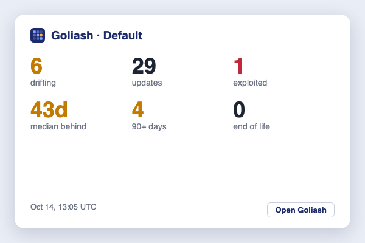

The numbers that matter at a glance, without opening Goliash: services drifting, updates waiting, how many of them
run an image with a vulnerability exploited in the wild, the median days production runs behind a newer release,
how many for 90+ days, and end of life. A tap or click opens the Security page.



## iPhone and iPad

Apple only lets installed apps put widgets on the home screen, so the widget runs in
[Scriptable](https://scriptable.app), a free app that makes widgets from a short script.

1. **Integrations → Widgets → Create a viewer token** (admins). The token can only read; revoke it any time under
   Workspace settings.
2. On the iPhone, open that page and tap **Download Goliash.js**: the server's address and the token are already
   in it. Open the file in Scriptable (**Share → Scriptable**); it is added as *Goliash*. (On a computer, **Copy**
   and paste it into a new script in Scriptable instead.)
3. Long-press the home screen, **+**, *Scriptable*, pick a size and add it; then tap the widget and choose
   *Goliash*.

**What it runs** under the button shows the script: it reads `/api/v1/summary` with the token and draws the
numbers, nothing else.

Every size works: small shows the median exposure, drift and end of life; medium adds updates, exploited
vulnerabilities and 90+ days; large adds services, how many run behind and stale targets; on the lock screen it is
one line. iOS refreshes widgets about every 15 minutes, as it sees fit. The phone must reach Goliash's address: over
the internet, or through a VPN to an internal one.

## Mac menu bar

macOS keeps Notification Center widgets for installed apps too, so on a Mac Goliash sits in the menu bar instead,
through [SwiftBar](https://swiftbar.app) or [xbar](https://xbarapp.com) (both free):

1. With the token from above, **Integrations → Widgets → Download goliash.15m.sh** (server and token filled in).
2. Move it into the plugin folder SwiftBar or xbar asked for on first start, and run `chmod +x goliash.15m.sh`.

The menu bar shows *Goliash* with a count: red for exploited vulnerabilities or end of life, amber for services
drifting, a ✓ when all is quiet. Its menu lists the numbers, each opening the page behind it, and refreshes every
15 minutes (the `15m` in the name). It needs only `curl` and `plutil`, which every Mac has.

## Windows 11

Installed from Microsoft Edge, Goliash brings its own widget to the Windows 11 Widgets board:

1. Open Goliash in Edge, choose **App available → Install** in the address bar (or *Apps → Install Goliash* in the
   menu), and sign in in the app's window.
2. Open the Widgets board (**Win+W**), **+ Add widgets**, and add **Goliash**.

It uses the app's sign-in, so it needs no token; when that sign-in ends, the widget asks you to open Goliash and
sign in again. It refreshes every 15 minutes and whenever the board opens. Windows shows widgets of installed web
apps only from Edge, and the Widgets board's own settings must allow them.

## For anything else

Both widgets read `GET /api/v1/summary` (see the [API reference](/reference/api/)), with a viewer token or a
session:

```sh
curl -s -H "Authorization: Bearer $GOLIASH_TOKEN" https://goliash.example.com/api/v1/summary
```

```json
{"workspace":"Default","production":"prod","services":18,"drifting":6,"updates":29,"exploited":1,"behind":14,
 "median_exposure_days":43,"behind_90_days":4,"end_of_life_passed":0,"stale_targets":0,
 "generated_at":"2026-10-14T13:05:00Z","generated":"Oct 14, 13:05 UTC"}
```

The same call feeds a wall screen, a status bar (SwiftBar, xbar, Waybar), a Home Assistant sensor or a Stream
Deck key.
